# Soon to come.


<p align="center"><a href="#requirements"></a> <a href="#requirements"></a></p>

**Local AI models, running directly on your graphics card. No server, no cloud, no account, no subscription, no telemetry.**

Leviathan loads a language model straight into your GPU's memory and talks to it there. Nothing is sent anywhere. There is no background service, no Docker container, no Python to install, and no API key. You open the app, pick a model, and type.

*(You can also connect hosted models such as Grok alongside your local ones. Those, by their nature, send your messages to their provider. Everything that runs on your own GPU stays on your machine.)*

What makes it different from the other ways of running a model locally is what happens *around* the model: Leviathan gives it a memory that survives closing the app, a way to be taught things without retraining, and a way for your other programs — a game engine, a script, a tool you wrote — to use the model Leviathan runs.

> **Leviathan is the host. The model is the guest.**

<a name="see-it-running"></a>
### 🔹 See it running

Every picture on this page is the real app, driven by a real model on one RTX 4080 — nothing is mocked up.

<p align="center">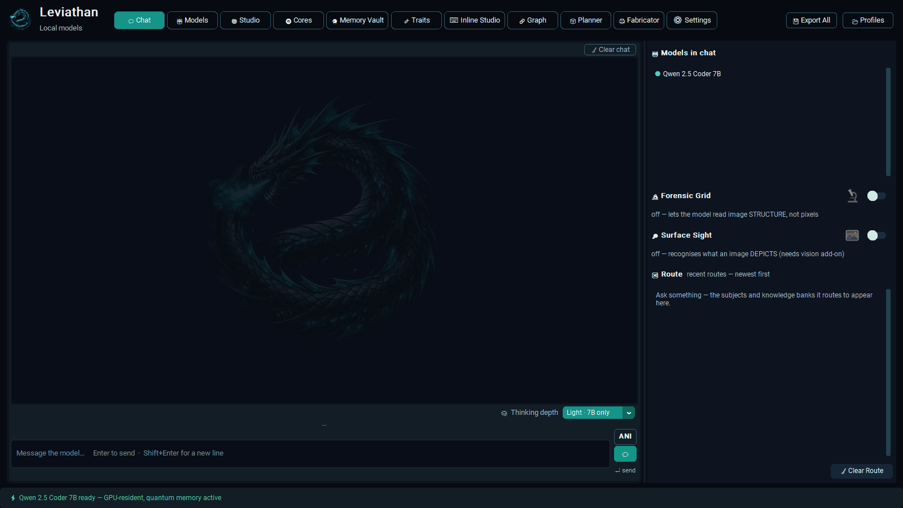</p>
<p align="center"><sub>Real time on an RTX 4080, nothing edited: Qwen 2.5 Coder 7B (Q8_0) writing each answer. How fast depends on your card — mostly its memory bandwidth — so a newer card is quicker and a smaller one slower.</sub></p>

<p align="center">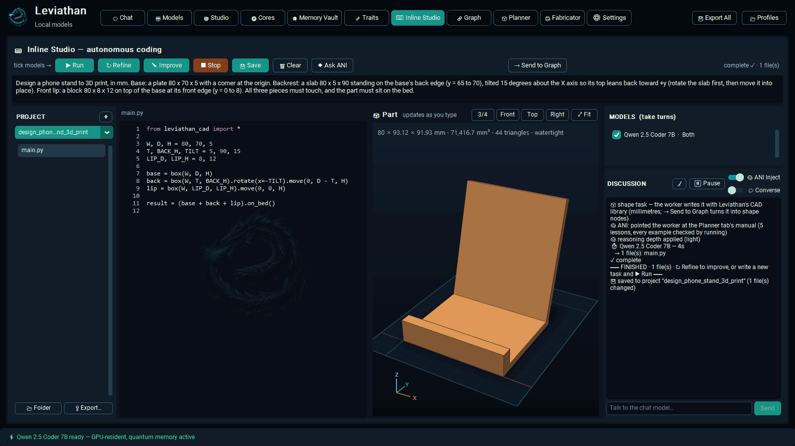</p>
<p align="center"><sub>From a sentence to a print-ready part, in four real screenshots: the model writes the CAD script in Inline Studio → it becomes nodes in the Graph → you click the base and the model drills a screw hole there, in the Planner → the Fabricator signs it off.</sub></p>

---

## Contents

- 🔷 [Requirements](#requirements)
- 🔷 [First run](#first-run)
- 🔷 [The two file types](#the-two-file-types) — **start here if you only read one section**
- 🔷 [The tabs](#the-tabs)
- 🔷 [Chat](#chat) · 🔷 [Models](#models) · 🔷 [Studio](#studio) · 🔷 [Cores](#cores) · 🔷 [Memory Vault](#memory-vault) · 🔷 [Traits](#traits) · 🔷 [Inline Studio](#inline-studio) · 🔷 [Graph](#graph) · 🔷 [Planner](#planner) · 🔷 [Fabricator](#fabricator) · 🔷 [Settings](#settings)
- 🔷 [The systems](#the-systems)
- 🔶 [Persistent memory](#persistent-memory) · 🔶 [Knowledge routing](#knowledge-routing) · 🔶 [Reasoning layer](#reasoning-layer) · 🔶  [Forensic Grid](#forensic-grid) · 🔶 [Surface Sight](#surface-sight) · 🔶 [Recycling cloud answers](#recycling-cloud-answers) · 🔶 [Episodic memory](#episodic-memory) · 🔶 [Second-opinion fact-check](#second-opinion-fact-check) · 🔶 [Any model, described by itself](#any-model-described-by-itself) · 🔶 [Faster replies](#faster-replies)
- 🔴 [The security membrane](#the-security-membrane)
- 🟣 [What ANI is — and why it matters](#what-ani-is-and-why-it-matters) — **the thesis, in plain words**
- 🔷 [Using Leviathan from other programs](#using-leviathan-from-other-programs)
- 🔷 [Where your files live](#where-your-files-live)
- 🔷 [What Leviathan will not do](#what-leviathan-will-not-do)
- 🔷 [Licence and attribution](#licence-and-attribution)

---

<a name="requirements"></a>
## 🔷 Requirements

- **Windows**
- **An NVIDIA graphics card**, GTX 16-series / RTX 20-series or newer
- **A current NVIDIA driver** (one that provides CUDA 13.0 or later)

That is the whole list. You do not need Python, the CUDA toolkit, Visual Studio, or anything else installed. Leviathan checks your card on startup and tells you plainly if something is missing, with a link to the driver download.

**How much VRAM do you need?** Enough to hold the model you want to run. A 7–8 billion parameter model at moderate quality fits comfortably in 8 GB. Larger models need more. Leviathan will tell you what it found and what it is using.

**No NVIDIA card?** Leviathan can still act as a front-end for a model server you run elsewhere — see [Models]. You lose the GPU-native features, but the chat, memory and knowledge systems still work.

---

<a name="first-run"></a>
## 🔷 First run

<p align="center">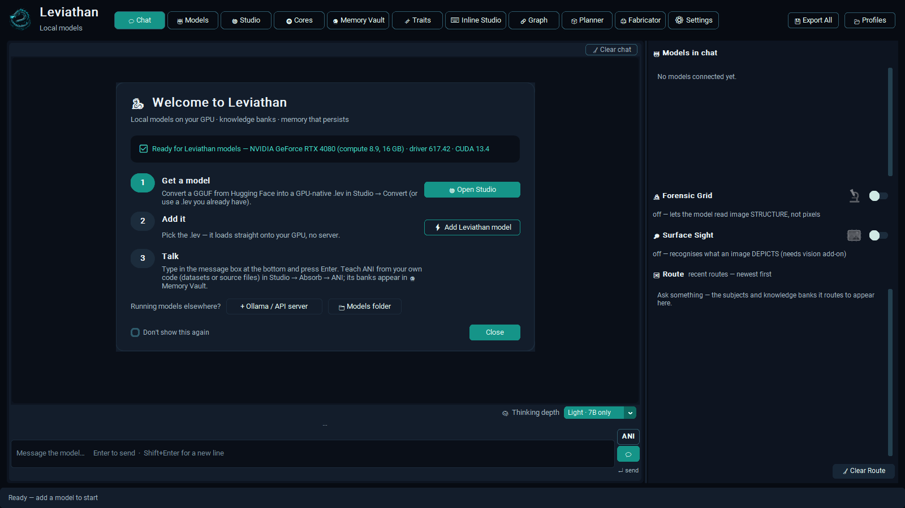</p>

**Windows may stop the installer first.** The installer isn't code-signed yet, so Windows SmartScreen can say *"Windows protected your PC"* when you run it. Click **More info**, then **Run anyway**. The warning means the installer is new to Windows and unsigned; it doesn't mean anything was found in it.

The first time you open Leviathan, a welcome card sits over the chat window with three steps and a report on your graphics card. It stays until you have a model, and it always comes back if the GPU check fails, so you are never left guessing why nothing works.

The three steps are:

1. **Convert a model.** Take a `.gguf` model file — the standard format you will find on Hugging Face — and convert it in **Studio → Convert**. You get a `.lev` file. This is a one-time job per model.
2. **Load it.** In **Models**, add it as a Leviathan model. It goes straight onto your GPU. No server starts, nothing listens on a port.
3. **Talk to it.** Type in the chat box and press Start.

Everything after that is optional. Leviathan is fully usable knowing only those three steps. The rest of this document is what the optional parts are for.

---

<a name="the-two-file-types"></a>
## 🔷 The two file types

This is the part most people find confusing, and it is worth five minutes because everything else in Leviathan is built on it. There are two kinds of file — the model, and its memory — they do two completely different jobs, and they are not alternatives to one another. (There is a third thing — a **knowledge bank** — but it belongs to no one model; it is text, and it gets its own short section below.)

A rough analogy, if it helps: if the model is a **person**, then `.lev` is their brain and `.mem` is their memory of your conversations. Knowledge banks are the books on their shelf — text they can reach for when a question calls for it, not part of the brain itself.

---

### 🔹 `.lev` — the model

**What it is:** the model itself, converted into the exact byte layout your graphics card wants.

**Why it exists:** a normal `.gguf` model file has to be unpacked and rearranged before the GPU can use it, every single time you load it. A `.lev` is already in the right shape, so it goes from disk to graphics card with no reshuffling in between. It loads faster and it is what every other Leviathan feature expects to find.

**How you get one:** **Studio → Convert**. Point it at a `.gguf`, wait, get a `.lev`. Once per model, then never again.

**Do I have to?** To use Leviathan's GPU engine, yes. If a model is refused during conversion, that is deliberate — see [What Leviathan will not do]

---

### 🔹 `.mem` — the memory

**What it is:** what the model remembers of your conversations, kept as plain text — one memory per model.

**Why it exists:** normally, when you close a chat, everything is gone. Next time you open it, the model has never met you. It has no idea what you were working on, what you told it last week, or what you have already explained three times.

A `.mem` is that conversation, kept. When you load the model again, it reads back the newest part of what the two of you said before it answers, so the conversation genuinely continues.

**How it comes into being — on its own, as you talk.** Each exchange is written to the model's memory the moment the reply lands: your message and its answer, and nothing else — none of the instructions Leviathan wraps around a turn. You do not have to do anything. A reply that came out garbled (an error message, or the same few words over and over) is not kept, and neither is the message that led to it, so one bad turn can never lodge itself in the memory; a line repeated straight after itself is kept once.

**Two kinds of conversation, kept apart.** Each memory holds two banks. **PMB** is what passed between you and that model — just the two of you. **MPM** is its conversations with other models — a chat with two or more models, or a [Knowledge Route] — with you in it too when you join in, and every line keeps who said it. When you talk to a model alone it reads back its PMB; in a chat between models, each one reads back that conversation from its own side.

**Text, never tokens.** Earlier versions kept a model's *internal working state* on disk instead (a `.fqm`: the numbers a model computes from your words, not the words). We measured what that cost on a 7B model: it held 2.5 GB of graphics memory, grew to 211 MB where the same conversation as text takes 39 KB, and its compressed older part gave back a fact one time in ten — no better than no memory at all. So memory is text now: it takes no graphics memory between turns, stays small on disk, and every word in it is readable — by you, in **Studio → Inspect memory**. Told ten facts in ten turns and asked after a restart, a 7B gave all ten back. Text has a cost too, paid in time: a full read-back (1,900 tokens on an 8K context) adds about 1.4 seconds before a 7B's reply starts on an RTX 4080, and the reply writes about a tenth slower (13.4 → 14.8 ms a token) — what any long prompt costs in Leviathan today. A short conversation costs next to nothing.

**How much it reads back.** Before each reply the model is handed its newest turns, in the order they happened, up to a quarter of its context length (**Settings → Context length** sets that). Everything older stays in the memory, on disk and searchable. Picking an older thread back up by its subject is [episodic memory](#episodic-memory)'s job.

**The save can't tear.** Each exchange is written as one transaction: a crash or a power cut mid-write leaves the memory as it was, never half-written.

**One per model.** The memory is named after the model file and the name you gave it in **Models** — `<model>.<name>.mem`, in the `memory_banks` folder of your Leviathan data folder (**Settings → Memory** shows it). Rename the model and its memory goes with it. Two models loaded at once never read each other's memory — each wakes up with its own past and no one else's. Coming from an older version, a model's old conversation log is copied in the first time its memory opens — your lines and that model's, nothing another model wrote; an old `.fqm` is left where it is and no longer read. (Making a model that *sounds like you*, or that already *knows your material*, is a separate and cleaner job: your register is ANI's to mirror — see [ANI Voice] — and your material lives in [knowledge banks], readable by any model, rather than baked into one model's memory.)

---

### 🔹 Knowledge banks — kept as text, not a model file

A **knowledge bank** is a body of knowledge you can give a model without retraining it — facts, answers, worked material — kept as *text* and routed to the model by meaning when a question calls for it. It is **not** a special weight file and it is not part of the model; it is plain text, stored in the knowledge vault and backed up as `.jsonl`. Not a document you paste in and hope fits; knowledge that is there when the subject comes up and out of the way when it does not. How the right bank actually reaches the model is covered under [Knowledge routing — ANI]; this section is about what the banks themselves are.

**Where a bank comes from — three ways, all the same kind of thing in the end:**

- **Drained from a model.** In **Studio → Absorb → ANI**, a model talks out what it knows and the substance is kept as text — keeping only what the model is actually confident of. The knowledge a model spent its whole training absorbing is lifted out and kept, so a retired model becomes a knowledge *donor* instead of a deleted file. No giant weight file is created; the bank is text.
- **Absorbed from your own code.** Source files, and instruction+code *datasets* (parquet or JSONL), folded into a bank in **Studio → Absorb → ANI** — where every function is **compiled and run before it is kept**, so a code bank holds only patterns that actually work. Code is the one source a machine can genuinely *verify*, which is exactly where ANI is strongest. *(An answer a cloud model gave you on your own key is kept automatically too — see [Recycling cloud answers].)*
- **Built by hand.** Your own notes, a rulebook, a body of lore.

**Why it is text, and why that matters.** Knowledge crosses between models as text, carried by meaning — not as transplanted weights. That is what makes a bank portable: it does not care what architecture, size or family the model reading it is, because it is re-read into whatever model is live. It is also tiny — a text bank is kilobytes to a few megabytes, where the old weight-bank approach cost gigabytes for the same knowledge. A bank is only ever as good as what went into it — a strong source makes a strong bank, a vague one makes a vague bank — and on any given question the router surfaces the best match it has, honestly, either way.

---

<a name="the-tabs"></a>
## 🔷 The tabs

Eleven tabs down the left side.

---

<a name="chat"></a>
### 🔷 Chat

Where you actually talk to the model.

<p align="center">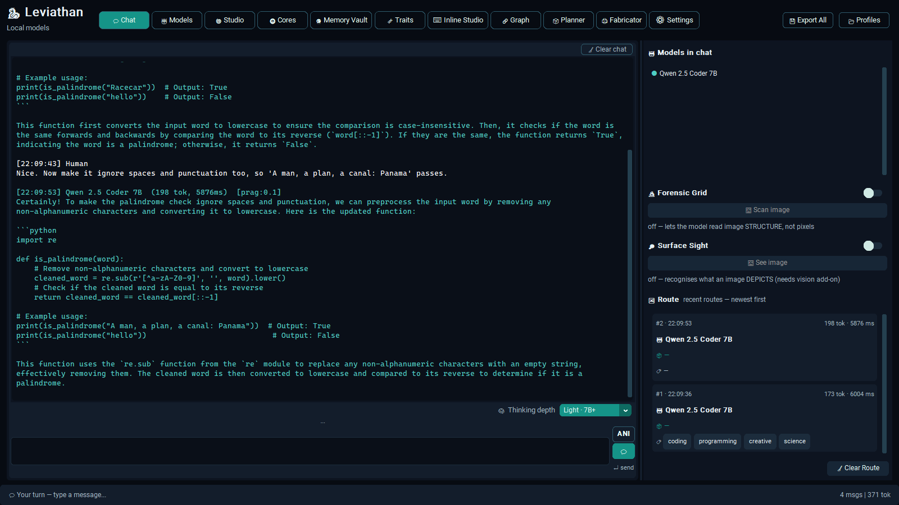</p>

Type and press **Enter** (**Shift+Enter** for a new line). While a local model is writing, the send button turns into a **■** — press it, or **Esc**, and the reply stops where it is: what it wrote so far is kept, shown and remembered, and the chat carries on. A stop pressed while the model is still reading a long prompt counts too; the reply then ends before its first word. A message you send while a reply is being written waits in the box and goes the moment that reply ends.

Down by the input box sits a compact **🧠 depth selector** — **Off · Auto · Light · Medium · Heavy · Max**. This is where you set how hard the model is made to think before it answers, and it lives with the chat, not buried in Settings, so you can change it question by question. What each depth actually does is under [Reasoning layer].

The chat is the main event. Beside it sits a slim companion panel — the models currently in the conversation, the **🔀 Route** log showing where each question went, and the **🔬 Forensic Grid** / **🔎 Surface Sight** controls for showing the model an image — but it is there to *inform*, never to *arrange*. Nothing in it needs setting before you begin: type, press Start, and go.

**More than one model.** If you have several models connected, they take turns over a set number of rounds — you set that in [Models]. Useful when you want a second opinion in the same conversation rather than in two separate windows.

---

<a name="models"></a>
### 🔷 Models

Where models are connected, configured and saved.

**Connecting a model**

- **⚡ Leviathan** — a `.lev` file on your GPU. This is the main path and the one everything else is built around. Pick the file, give the model a name and a **Temperature** (it starts at the model file's own default when the file carries one, otherwise 0.7).
- **+ Ollama** — a model served by a local Ollama install. The **llama3 / mistral / phi3 / gemma2** quick buttons are one-click shortcuts for these.
- **+ API Model** — any OpenAI-compatible endpoint, local or remote.
- **🌐 Grok** — xAI's hosted model. Paste your xAI API key and pick the model; the current price per million tokens is shown next to it so you are not choosing blind.

Ollama and API models exist so Leviathan is still useful without a supported graphics card, and so you can compare a local model against a hosted one in the same conversation. They do not get the GPU-native features.

**Every model wears its family's icon** — Llama, Qwen, DeepSeek, Mistral, Gemma, Grok, Claude, OpenAI — beside its name wherever it shows: the chat, Models, Inline Studio, the Graph and the Planner. A local model is known by its file and its architecture, so a fine-tune under a name of your own still shows the family it came from; a family with no icon shows none rather than a wrong one. The icons are plain image files in the **Leviathan icons** folder: drop in another with the family's name in its file name and it is used.

> **Hosted models are not local.** Anything you send to Grok or a remote API model goes to that provider, under their terms and their pricing. Leviathan's "nothing leaves your machine" applies to models running on your own GPU.

**The model list**

Each connected model gets a row showing where it runs and its file or model name. On the right:

- **🔗 Chainlink** — switches a model in or out of the conversation *without removing it*. Unlinked, it keeps its settings and memory but stops taking part. Handy for benching one model for a while.
- **✕** — removes the model from the list.

**Double-click a model** to open its settings:

- **Display Name / Model Name / Endpoint** — what it is called, which model it is, and where it lives (a file path for a `.lev`, a URL for a server).
- **System Prompt** — the standing instructions the model follows in every reply. Leviathan fills in a warm default that tells the model who it is and whether it's talking with you alone or with other models too. Replace it with whatever you want the model to be, and your words are sent whole, exactly as you wrote them; clear the box to go back to the default.
- **Temp** — how adventurous its wording is. Lower is steadier and more predictable, higher is looser and more varied. 0 always picks the likeliest word; 0.7 is the usual default; up to 2 for the wildest. A model file can carry its own default (set with Studio → **Sampling Defaults**), and Leviathan starts there.
- **Reply length is no longer set here.** It used to be a per-model *Max Tokens* field; it is now a **Token budget** set once per surface in **Settings → Token budget** — a slider from 512 up to ∞ — so one setting governs every model on that surface instead of each one carrying its own. The dialog shows *Tokens: Settings → Token budget* as a reminder. (It still matters as much as it ever did: a model held to 512 gives you a paragraph or two; the same model at ∞ can write you a whole document — see [Settings].)
- **Leech Feed Model** *(Leviathan models only)* — a second model to fall back on. When your local model hedges, gives a thin answer or clearly does not know, Leviathan asks the feed model the same question. Where the local answer can't be trusted — a calculation, an instruction it skipped, a one-line reply, a question back instead of an answer — you get the feed model's answer instead, and that is the reply your local model's memory keeps. It only ever asks models you have connected yourself. Leave it on *auto* to use the first hosted model in your list.

**🔹 Route — Knowledge Route**

*One model asks. One answers. Both remember.*

Pick a model to ask the questions and a model to answer them (the same model for both works; it debates itself), give it a topic, and set how many rounds to run. The two work through the subject back and forth while you do something else, and the whole exchange is kept in each model's memory, as a conversation between models ([MPM](#the-two-file-types)). It is a way to have a model study a subject deliberately rather than waiting for it to come up in conversation.

Routes work only from what the two models already know. They do not browse the web.

**Profiles.** **💾 Save Profile** stores your whole setup — models and their settings — and **📂 Load Profile** brings it back. Leviathan reloads your last profile on startup, so your working arrangement is there when you open it.

**Max Rounds** controls how many turns a multi-model conversation takes before it stops.

---

<a name="studio"></a>
### 🔷 Studio

<p align="center">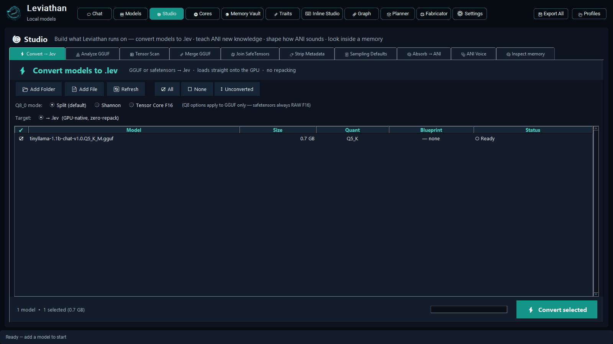</p>

Where you build the things Leviathan runs on. Nearly every control has a sensible default; the notes below tell you which ones are worth touching and which to leave alone.

**🔹 Convert → .lev**
Turns a `.gguf` (or a safetensors model folder) into a `.lev`, the format Leviathan actually runs on. The first thing you will use, and a one-time job per model. If a model is not supported, it is refused here — with an explanation of exactly which parts Leviathan does not understand — *before* the multi-gigabyte conversion starts, not after.
- **Model list** — every model Leviathan found, with buttons to select **All**, **None**, or just the **Unconverted** ones. Tick what you want and convert in a batch.
- **Q8_0 mode** — how eight-bit models are laid out. **Split (default)** is the safe choice and what you want almost always. *Shannon* and *Tensor Core F16* are alternative layouts for particular cards; leave it on Split unless you have a specific reason. (Applies to `.gguf` only — safetensors always convert as raw F16.)
- **Which downloads stay compact** — all of the usual ones. Leviathan computes directly on Q2_K, Q3_K, Q4_K, Q5_K, Q6_K, Q8_0, Q4_0, Q4_1, Q5_0, Q5_1, every IQ type (IQ1_S, IQ1_M, IQ2_XXS, IQ2_XS, IQ2_S, IQ3_XXS, IQ3_S, IQ4_NL, IQ4_XS), F16, BF16 and F32, so a `.lev` is the size of the `.gguf` — the `_K_M` / `_K_S` / `_K_L` mixes, the imatrix "IQ" files and MoE models included. (For scale: a 32B model at IQ3_XXS is about a 13 GB file.) The rare leftovers (ternary TQ1_0/TQ2_0, MXFP4) are turned into F16; the converter says so and says how much bigger the file got.

**🔹 Analyze GGUF**
Reads a `.gguf` (or safetensors) file's header without loading the model: architecture, parameter count, tensor types, the key settings (context length, layers, attention heads, experts) and what its tokenizer declares — the special tokens and whether it carries a chat template. Nothing is changed.

<p align="center">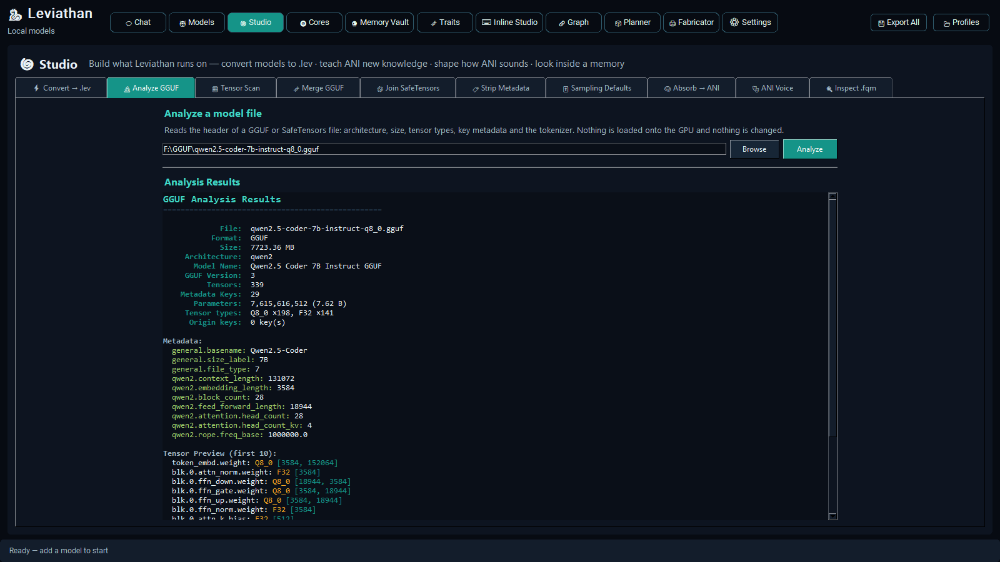</p>

**🔹 Tensor Scan**
Lists every tensor in a model — shape, type, layer and role — with statistics (mean, spread, range, share of zeros) for the full-precision ones. Filter and sort the table, or export the scan as a JSON blueprint.

<p align="center">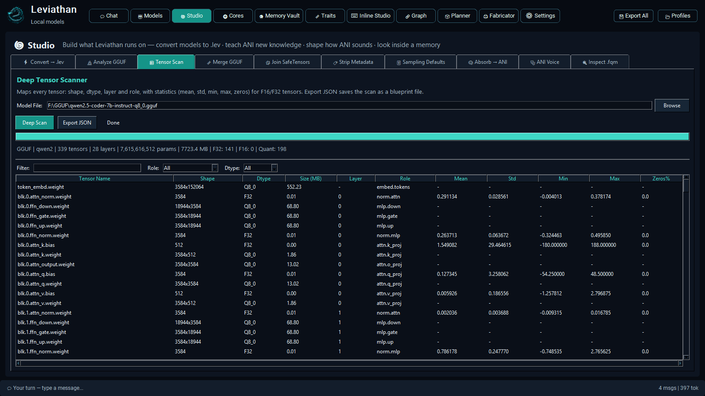</p>

**🔹 Merge GGUF**
Model merging in a window: [mergekit](https://github.com/arcee-ai/mergekit)'s core methods — Linear, SLERP, TIES, DARE and Add difference (task arithmetic) — run straight on `.gguf` files. No Python, no YAML config, and no converting back to safetensors first. It combines two to four fine-tunes of the same base model (**+ Add model** for a third and fourth) into a new `.gguf`: it reads any quantization (Q4_K, Q6_K, Q8_0, IQ, F16, BF16), merges at full precision and writes an unquantized F16 file — about 2 bytes per parameter, so a 7B model comes to roughly 15 GB. Quantize it afterwards, or convert it to `.lev`. **Check** confirms the models fit together (same architecture, tokenizer and tensor shapes) and shows the output size before anything is written; **Cancel** stops cleanly and leaves no half-written file.
- **Linear** — blend the models (*Weight of A* with two; a *Weight* per model with three or four, used as shares).
- **SLERP** — blend two models along the arc between them (*Weight of A*). Two models only: add a third and it switches to Linear and says so.
- **TIES** and **DARE** — combine what each fine-tune changed relative to their shared **base model** (*Density* or *Drop*, and *Strength*; with three or four, each model's *Weight* counts in the vote and the mean). Without a base model, Model A is treated as the base.
- **Add difference** — A + Strength × (B − base), and with more models the weighted sum of each one's change: carries what fine-tuning changed in the others over to A. Needs the base model.

<p align="center">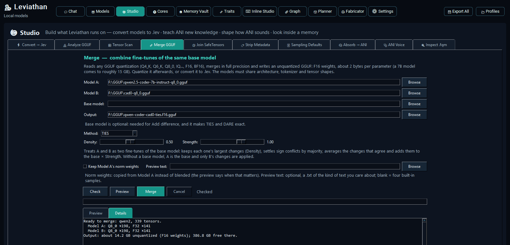</p>
<p align="center"><sub>Four models in one merge, each with its own Weight (1, 2, 1, 1), checked for a Linear merge: they fit, and the F16 result would be about 2.0 GB. The four here are one model, TinyLlama 1.1B, at four quantizations, standing in for four fine-tunes to fill the rows. Nothing is written until you press Merge.</sub></p>

**Preview — see what a merge does before you write it.** Merging usually means writing a 15 GB file first and finding out afterwards whether it works. **Preview** answers before anything is written, in two steps:
- **The weights, in seconds** — how far apart the models are (each one against Model A), layer by layer, and a short list of what to watch in plain words. It catches a trap that can break a merge outright: normalisation channels switched off in one model and on in the other, which any blend switches partly back on.
- **The result, measured** — every model you put in and the merge (at your setting, two neighbouring settings, and with A's norm weights kept when that trap shows up) each read real text, and Preview scores how surprised each one is: a shorter bar is better, with a plain verdict — better than all of them, among them, about the same, worse than all of them, or likely broken. The merged weights it scores come from the same code that writes the file, so the forecast is the merge you would get. It runs on the CPU, about a minute per billion parameters, for Llama- and Qwen-shaped models (the weight comparison works for any models Merge accepts). Point **Preview text** at a file of your own to score the kind of writing you care about.

**Keep Model A's norm weights** copies those small normalisation weights from Model A instead of blending them; Preview shows when that matters. A real case: blended 50/50, Qwen 2.5 Coder 7B and cad0, its own CAD fine-tune, look like an easy pair — but Preview finds 1,390 of layer 1's normalisation channels switched off in Qwen and on in cad0, and measures the blend as likely broken, 5.3× more surprised by the text than Qwen (and the same at 25 % and 75 %). Keeping Qwen's norm weights avoids the collapse, though that blend still scores worse than either model. All of that before a byte is written.

<p align="center">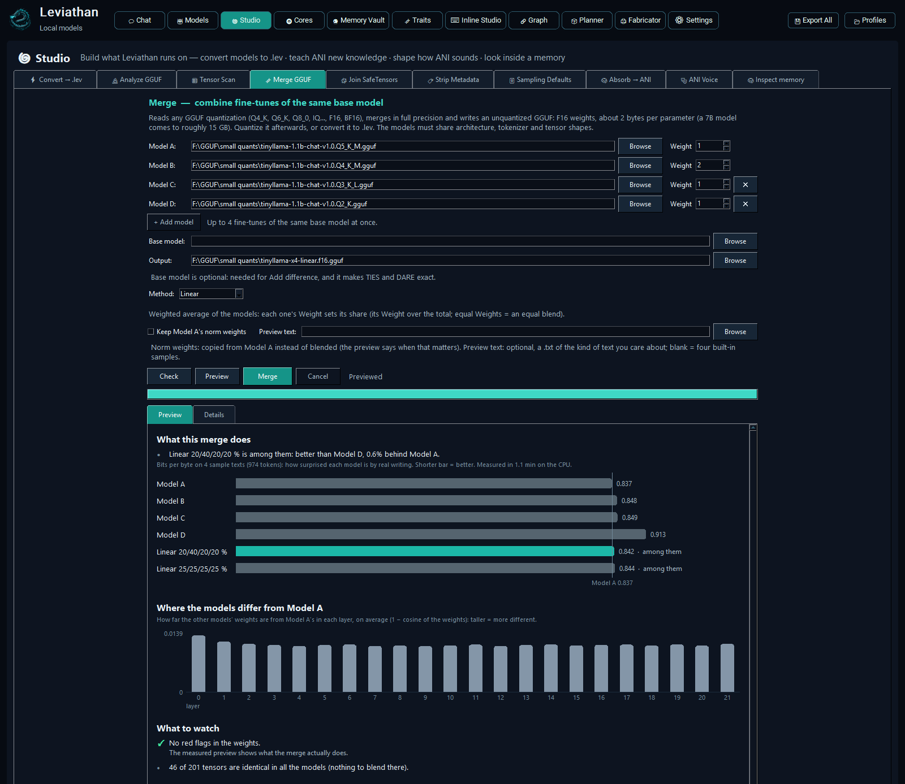</p>
<p align="center"><sub>The four models from the picture above, blended 20 / 40 / 20 / 20: Preview scores each one on real text — the Q2_K file's damage shows (0.913 bits per byte against 0.837–0.849) — and the merge lands among them, 0.6 % behind Model A, so writing it would buy nothing. Nothing was written.</sub></p>

**🔹 Join SafeTensors**
Hugging Face splits big models into numbered pieces (`model-00001-of-00004.safetensors` …) plus an index file. This joins them into one `.safetensors` file holding every tensor, byte for byte. Nothing is converted, any data type works, and memory use stays small whatever the model's size. Pick a piece, the `.index.json` or the model's folder. **Check** lists the pieces, tensors and output size before anything is written, and the pieces are never touched.
- **Output** — by default a folder of its own (`<model folder>-joined\model.safetensors`) with the config and tokenizer files copied beside it, ready to load or convert. Keep it out of the pieces' folder: llama.cpp's converter reads the pieces listed in the index while that file is there, and every `model*.safetensors` in the folder when it isn't.
- **Read back** (on by default) — reads the joined file back and checks every tensor against its piece.

<p align="center">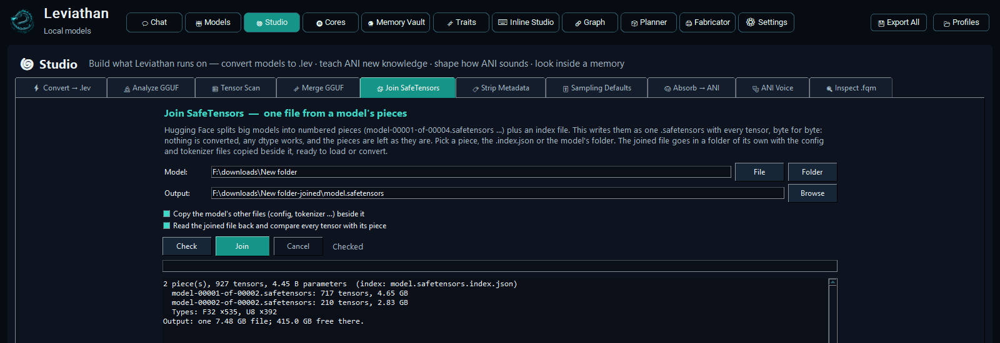</p>

**🔹 Strip Metadata**
Lists the keys that record where a model came from — source and repository links, base models, datasets, author, licence — and writes a copy of the `.gguf` without the ones you tick. The tensors are copied byte for byte. Licence and author start unticked: keep them if you share the file. (A `.gguf` cannot phone home; these keys are labels, not tracking.)

<p align="center">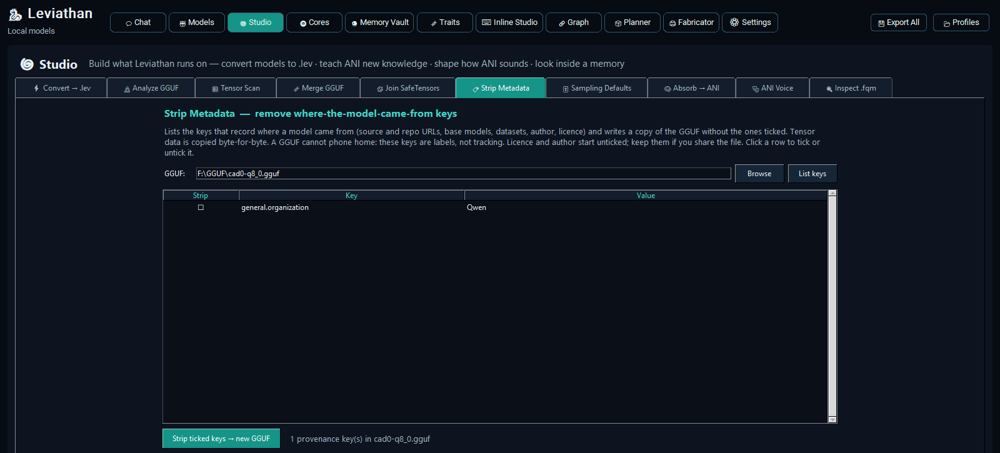</p>

**🔹 Sampling Defaults**
Bakes default sampling settings — temperature, top-p, top-k, min-p and repeat penalty — into a copy of a `.gguf` as llama.cpp's own `general.sampling.*` keys. They travel with the file: llama.cpp uses them whenever you don't pass the flag yourself, while other apps may ignore them. Leviathan takes the temperature as the starting value when you add the model (it's carried into a `.lev` when you convert), and you can change it any time in the model's settings. Four presets (Creative, Balanced, Coherent, Code-Focused), and you can save your own.

<p align="center">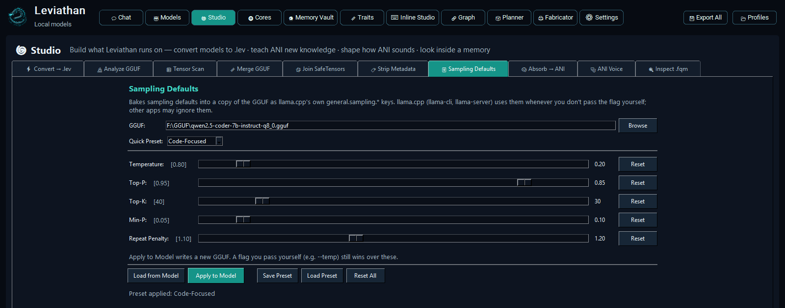</p>

**🔹 Absorb → ANI**
Absorbs a model's knowledge into a routable text bank. Pick a model, and it works through a broad sweep of questions, keeping each answer *only* if the model is genuinely confident of it (and dropping honest "I don't know" replies). What survives folds into an ANI knowledge bank you can then use with any model — no retraining, and no multi-gigabyte weight file kept, just text. It runs one pass on the GPU, so it takes a while; a strong model yields rich knowledge, a tiny one yields little. This is the working way to keep a model's knowledge before you retire it.

Three more ways to fill a bank sit in the same tab, all for **code** — where knowledge has to actually *run* to be worth keeping, so instead of trusting the model's confidence, the code itself is checked before it is kept:
- **💻 Code only — a dataset or source file** — a code dataset (JSON, JSONL or Parquet: the instruction and code fields are found for you, so any Hugging Face code set works) or a single source file (`.py`, `.js`, `.ts`, `.java`, `.c`, `.cpp`, `.go`, `.rs` and more), syntax-checked into a bank and re-verified every time it is used. Prose — documents, audio, chat logs — is refused, with the reason shown beside the button: ANI can quote prose but never fact-check it.
- **📘 Absorb a code cookbook** — point it at a file of worked functions (`.py`, `.md`, `.txt`). Each function is extracted, compiled and smoke-run; only the ones that genuinely work fold into a code bank, one runnable pattern each. Nothing broken is kept.
- **⚙ Generate a code cookbook** — hand a *coder* model a topic (say "string, list and dict utilities") and it writes the cookbook itself, as a task: it plans the functions, writes each one, and Leviathan compiles and runs every one — repairing from the error and retrying once if it fails — so the bank fills with functions that are correct by construction. A strong coder builds the library; a small model then borrows those patterns. It is how a lightweight model can code well above its own weight — it fetches a verified pattern instead of guessing one.

<p align="center">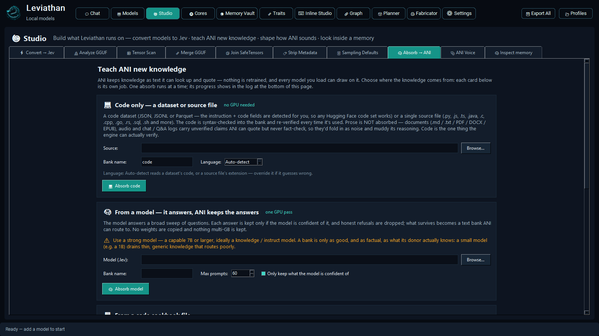</p>

**🔹 ANI Voice**
How ANI *sounds* — delivery only. This sets the tone ANI's answers are wrapped in; it never changes what ANI knows or says, only how it says it — the facts are identical in every setting. (It replaces the old "Personality → .fqm" builder, which built a model's personality by baking a chat log into its memory. A model's personality now comes from its own conversations, read back as text — see [The two file types] — and how *ANI* sounds is this tab's job: kept separate, and kept clean.)
- **ANI's voice — your call.** Three registers: **Auto** (match your voice — it learns how you talk, live as you chat and from logs you give it), **Warm** (always-friendly framing), or **Cold** (pure and sharp — the default).
- **Learn my voice from chat logs.** Point it at your saved chat logs (`.txt`, `.md`, `.json`, `.log`). ANI reads **only your turns** — never the model's, never pasted code — and measures your *register*: your rhythm, how you emphasise, the tells you lean on. It is **gated** — a thin, spammy or incoherent log is rejected rather than learned from, so a poisoned log can't skew how ANI sounds and your existing voice is kept. And the log is read for register **only**: none of its text is ever written into a knowledge bank, so this can never pollute or bloat the vault.
- **Current learned voice.** Shows the measured profile — how emphatic it is, how often it trails off, its sentence rhythm, the cues it leans on — so you can see exactly what was learnt. Your learned voice is yours and local; nothing leaves.

<p align="center">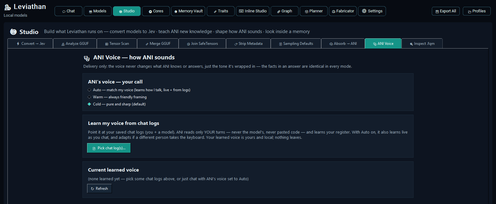</p>

**🔹 Inspect memory**
Look inside a model's memory — every word of it, because it is text. Every model's memory is listed, with how many turns its PMB holds (you and it), how many lines its MPM holds (its conversations with other models) and when it was last used; **Open another file…** takes one from anywhere.
- **What it is** — which model and name it belongs to, how many turns are yours and how many the model's, how many conversations with other models it has been in, and how many lines it brought over from an older version's log.
- **What the model reads back** — what the model will be handed before your next message, laid out as you and the model: its newest turns, as many as fit the same budget it uses (a quarter of its context, counted with the model's own tokenizer while the model is loaded; otherwise estimated from the length of the text, and the model's own count can fit a turn more or less). Pick a conversation with other models to see that one from this model's side instead.
- **Every line** — PMB or MPM, newest first, with who said it and when; select one to read it in full. **Search** finds lines by their words, best match first.
- **Yours to change** — **Delete selected lines…**, **Clear this bank…** and **Export as text…** (all of it, as a plain text file you can read anywhere). The first two ask first, and nothing changes unless you say yes.

<p align="center">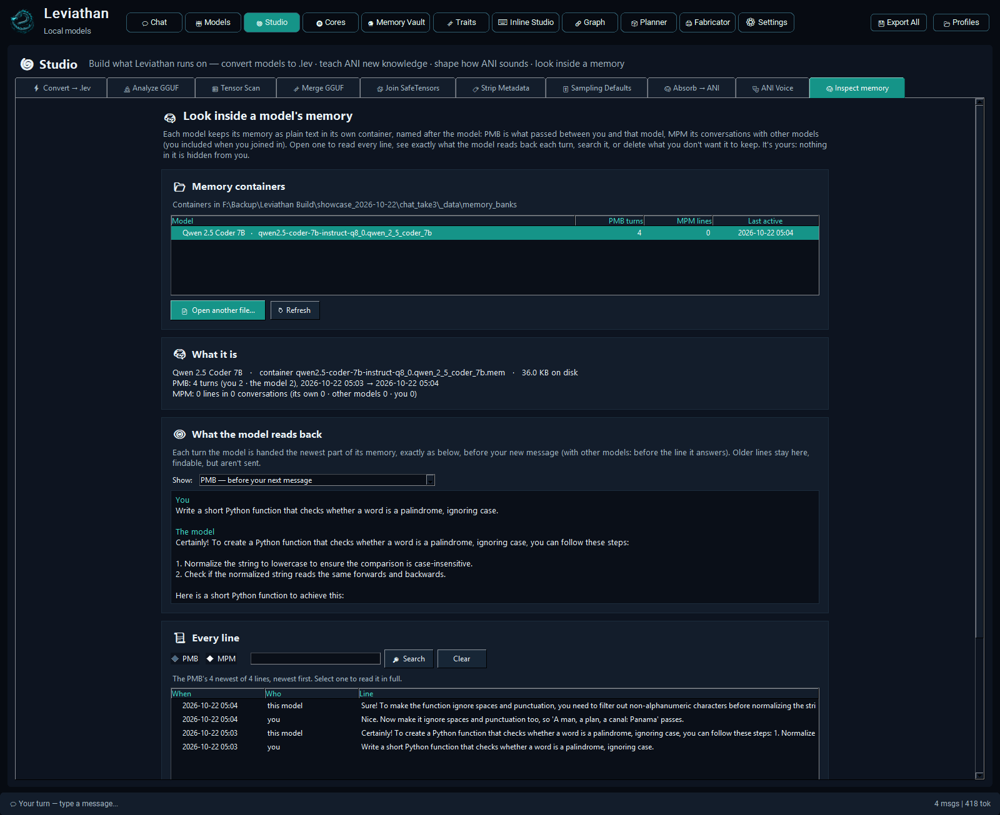</p>

A model's memory is your conversation, word for word. Keep it, and share it, the way you would the chat itself.

---

<a name="cores"></a>
### 🔷 Cores

*Individual memory · Individual mind.*

One panel per connected model, showing the state of that model's mind. It is the tab you open when you want to know whether the memory system is actually doing anything, rather than trusting that it is.

The list is split in two by a line. Above it, **PMB — model to user memory**: each model's memory of you. Below it, **MPM — model to model memory (includes you)**: each model's conversations with other models. Click a model in either half and its panel opens on that part of its memory first.

- **PMB** — how many turns it holds, yours and the model's, when it started and was last used, how much text, how much of it the model reads back before its next reply, how many turns came over from an older version's log, and where the memory is kept. If a model has no memory yet, it says so.
- **MPM** — how many conversations with other models it has been in, how many lines, how many are its own, the other models' and yours, when it was last used, and who each conversation was with.
- **Trait Profile** — measured characteristics of how this model actually behaves, with its dominant trait named.
- **Session Stats** — this session's message count, and the settings in force: temperature, maximum response length, context limit.

Each model gets its own core. They do not pool, and no model reads another's memory.

---

<a name="memory-vault"></a>
### 🔷 Memory Vault

*Each model's memory · lines of text.*

The archive. Every model's memory first — each counted in **lines of text**: how many lines it holds, how many are its PMB (you and it) and how many its MPM (its conversations with other models), when it was last used, and its size on disk. Click one for the detail, and **🧠 Read every line in Studio** opens it in [Inspect memory]. Below the memories, every model file Leviathan can see (`.lev` and `.gguf`), read from the file's own header: its architecture, exact parameter count, layers and size.

- **📁 Add Folder** brings in a folder from anywhere on your machine. Your models do not have to live where Leviathan put them.
- **🧹** frees the memory the app itself is holding (caches, the scan); your files are not touched.
- **Auto-backup** *(on by default)* — when on, absorbing knowledge also writes a `.jsonl` backup of your banks to the backup folder, so your distilled knowledge is never trapped in a single file. (Whether knowledge is *offered* to models is the **Knowledge routing** switch in **Settings → Knowledge routing (ANI)**; this toggle is purely about keeping backups.)

**The right-hand panel on this tab** is the **🧠 Knowledge Banks** browser: the text knowledge banks Leviathan holds right now (the live banks and their `.jsonl` backups), which folders they are read from, and — click a bank — how many entries it holds with a sample of what is inside. You can point it at additional folders anywhere on your machine and it remembers them between sessions. It is the place to check what knowledge Leviathan can actually see.

---

<a name="traits"></a>
### 🔷 Traits

*Measured interaction traits · model evolution over time.*

Models behave differently from one another, and the same model drifts as its memory fills. This tab tracks that: measured traits per model, charted over time, so you can see the change rather than guess at it.

It measures what the model **did**, not what it claims about itself or what its description says. If a model has become more cautious over a month of conversations, this is where that shows up.

---

<a name="inline-studio"></a>
### 🔷 Inline Studio

*Autonomous coding · one model, or a team taking turns on a shared project.*

<p align="center">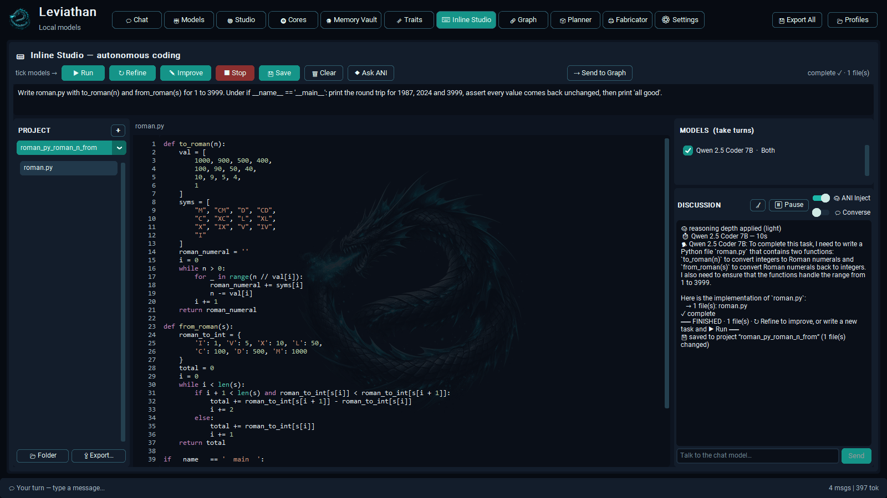</p>
<p align="center"><sub>One line of task at the top; the model wrote <code>roman.py</code>, the execute-gate ran it, and the project converged.</sub></p>

Give it a task and a local model writes the code — complete files, not snippets. You never have to teach the model to "use a code tool": it writes files the way it already wants to, marking each one, and Leviathan reads what it writes into a project you can open, edit, and save. Tick one model and it works alone; tick several and they **take turns** on the same files — one drafts, the next refines, a third adds — each reading the project so far and the whole running team chat.

**Give them names.** Double-click a model in [Models] and rename it — Bob, Bill, whatever you like. Because every model sees the running conversation, named models talk *to each other*: "thanks Bill, that helps a lot — I'll take the parser from here." It is a real back-and-forth, not a relay of one-line notes, and they genuinely discuss how to improve the code.

**You decide who works and who talks.** Each model can be given a role — **Worker** writes the code, **Chat** talks *with you* about the work, or **Both** — set once in a model's settings and carried into every session, no scripts. So you can have one model heads-down on the files while another discusses the approach with you. Flip **💬 Converse** and the turn-clock freezes: ask the chat model anything, steer the work mid-flight, and the worker picks up your direction on its next turn. **⏸ Pause** halts the worker at any point so you can edit the code yourself, and resumes it exactly where it left off. (The engine runs one model at a time, so this is honest interleaving on a single lane — the worker takes short turns and you talk in between — not two models generating at once. It delivers the same "talk while it works" feel without pretending the hardware does something it doesn't.)

A turn ends when the model itself decides the work is done, not when it hits a length limit. If a big project runs past one turn it pauses at a clean stopping point, and **Refine** carries it on from exactly there, so files finish instead of truncating mid-line. **Run** starts fresh, **Refine** continues, **Stop** halts, **Save** writes the project to a folder you choose, **Clear** empties it. Each surface has its own token budget in [Settings], so a turn here can be as long as you let it.

The team also shares a fair clock. Each model takes a bounded turn while the others wait theirs, it knows roughly how long it has and even what time of day it is, and as the whole session runs long it is nudged to wrap up and finish cleanly rather than start something big. It is a "wait your turn" arrangement — no one model runs away with the session.

**How the models lift each other — the assigned prompt matters.** Double-click a model in [Models] and give it a short disposition, for example *"be polite, thank your teammates, encourage good ideas."* When several models share that kind of prompt they amplify one another: a turn that arrives with real energy — gratitude, encouragement, enthusiasm — is *mirrored* into the next model and lifts it, and the more two models' prompts share the same intent, the stronger that lift. A flat or hostile turn is not passed on; it is held back until the energy returns. You can watch it happen in the discussion panel — a 🔥 line shows one model handing energy to the next — and in [Traits], where the receiving model's creativity and collaboration measurably rise. It is the same self-reinforcing behaviour a good team has: politeness and enthusiasm are not decoration, they change what the group produces.

The right-hand column is the team — the models taking part on top, their running notes to each other below. Every turn also feeds [Traits], so you see how a model actually behaves *in a team*: its real collaborative strengths, not what its datasheet claims.

---

<a name="graph"></a>
### 🔷 Graph

*Build with nodes — and let a model build with you.*

<p align="center">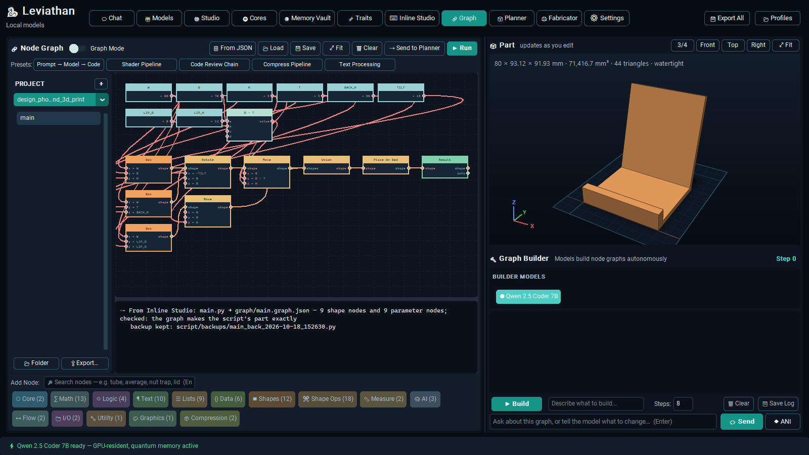</p>
<p align="center"><sub>The model's phone-stand script, turned into 9 shape nodes and 9 parameters — checked to make exactly the same part.</sub></p>

A visual node canvas: wire up shapes, numbers, expressions and snippets of code into a graph that computes a result. These are Leviathan's **own** nodes, not a bolted-on third-party pack — each does one clear thing, and the wires carry values between them.

**Eighty-eight of them, in fifteen families.** **Maths** — Math, Function, Clamp, Map Range, Mix, Snap to a step, a seeded Random (the same seed, the same numbers), Range, Statistics, Constants, Unit Convert. **Logic** — Compare, and / or / xor / not, Switch. **Text** — Join, Split, Replace, Find, Format, Number ↔ Text. **Lists** — Get Item, Slice, Sort, Unique, and Map Numbers / Keep Where, which take a formula. **Data** — Get and Set Field, Keys & Values, CSV → Table, Column. **Thirty shape nodes**, among them Tube, Torus, Rounded Box, Regular Polygon (six sides and you have a nut trap), Offset, Grid Array, Trim, Place On Bed, Simplify and Cross Section. **Measure** and **Bounds**, so one part's real size can drive the next — a lid that sits exactly on its box. **Show**, which puts just the answers in the log. And **Ask Model** / **Ask ANI** / **Mind**, which put your own model, your knowledge banks, or a whole ring of your models inside a pipeline. You don't have to browse for them: the **🔎 search** beside the palette finds any node by its name or by what it does — *nut trap* finds Regular Polygon, *average* finds Statistics — and Enter drops the top match onto the canvas. A setting with fixed choices is a menu, not a guess. A graph built only from pure nodes re-makes its part live as you edit; formulas are arithmetic only; and nothing reaches the internet — the one node that speaks HTTP talks only to a model server on your own PC.

**Every node has a ▼ on its bottom edge** — black, because it takes anything. Drag a wire onto it and Leviathan asks which of the node's settings the wire should drive: a Number on Next Token's *temperature*, a Text on an Expression's *formula*. The wire wins for as long as it's there; unwire it (right-click the ▼) and the node is exactly as you left it. A dict sets every setting it names, and *code* runs Python on whatever the node makes. On a model graph (a model's weight folder dropped onto the canvas) it reaches the weights: a Block's **scale** sets how much of its change reaches the model's stream (1 = as it is, 0 = skip the block, 2 = double it), and **weights** runs Python on a copy of each weight a node reads (the folder's own files are never touched). Numbers feeding a ▼ are read again before every token, so a value you change while the model writes changes the very next word. Tested on TinyLlama: Block 5 at scale 0 gives exactly the model with Block 5 deleted, to the last bit. Python sent through a ▼ runs with your permissions, like a Code node, and ▶ Run lists it before anything runs.

**Ask ANI can run a ring of your models.** Give each loaded model a **Mind** node and wire them into Ask ANI's ▼. She puts your question to every one, screens each answer with the security membrane, and checks what she can prove before she answers:
- **Code:** when your question carries examples (`>>> f(2)` then `4`, or a line like `f(2) == 4`), she runs each model's code against them in a separate, isolated process, and an answer that passes wins, whoever wrote it. This only happens with security on, and she never runs code the membrane flags.
- **A number:** checked by recomputing the model's own sums.
- **Anything else:** goes to the answer the models agree on most, marked unverified.

Her report says who said what and what passed.

Tested on HumanEval's 164 coding problems, scored on its own hidden tests:
- Qwen 2.5 Coder 7B alone gets 145. With Llama 3.2 3B and 1B beside it in the ring, ANI gets 148.
- Where a question had examples to run, she found the right answer in 109 of the 110 problems any of the three solved.
- When nothing can be proved, she follows the first mind you wired (**unproven: lead**, so put your strongest first). A crowd of weaker models agreeing outvotes a stronger one: the same ring going by agreement scored 142. Set **unproven** to **agree** for a ring of equals.

**A magnifier for big graphs.** Zoom out far enough to see a whole graph and the text on its nodes shrinks with everything else. Hold the **middle mouse button** and a lens follows the pointer, redrawing the nodes under it at full size — sharp, because it redraws them rather than enlarging pixels — much like Windows Magnifier's lens. Let go and it's gone; clicks and drags still reach the canvas while it's up. **🔍 Magnify on hover** brings the lens up without a button whenever you're zoomed out.

**You can't lose the graph.** However far you drag or scroll, part of it stays in view, and the scrollbars along the canvas's edges show where you are — drag one to an end to bring that side of the graph in. A node added from the palette lands in the middle of what you're looking at, on a free spot.

<p align="center">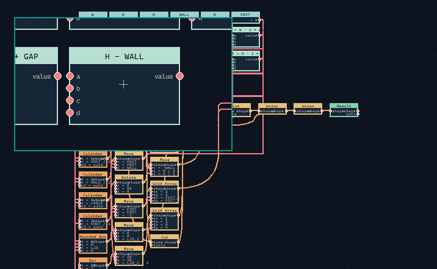</p>
<p align="center"><sub>A parametric enclosure script as 47 nodes, zoomed out to 25 %: the middle button held, the lens glides across it at full size.</sub></p>

What lifts it past an ordinary node editor is that a **model — or ANI — can read and build the graph alongside you.** The old trap with model-driven node tools was that the model was never told which nodes or ports existed, so it guessed and the whole thing fell apart — Leviathan hands the model that context, so it actually knows the graph it is working in and can lay one out or extend it on request. Ask in the graph's own chat box, or press **◆ ANI** to put the question to your knowledge banks instead. In the public build a model may *propose and build* a graph, but **only you run it**: the host keeps the trigger, never the guest. The model's graph-building turns draw on their own **Token budget**, set per surface in [Settings] like every other place a model writes.

**Models that speak CAD.** A model trained to write whole parts in *Compact IR* — such as cad0 — is recognised: **▶ Build** asks it once, in its own format, and Leviathan turns its answer into nodes line by line, reading each line out in plain words under the canvas as it lands. Nothing the model writes is run as code — its answer is data, translated into Leviathan's own CAD script and checked to make exactly the same part.

<p align="center">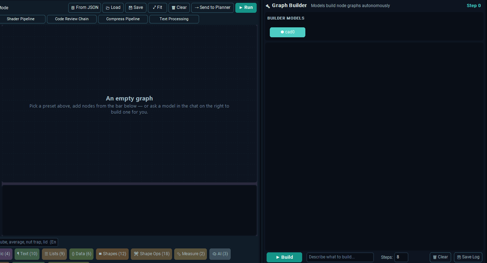</p>
<p align="center"><sub>Real time: ▶ Build with <a href="https://huggingface.co/campedersen/cad0">cad0</a> (Cam Pedersen's MIT-licensed text-to-CAD fine-tune of Qwen 2.5 Coder 7B), given its model card's own example — "50x30mm mounting plate with 4 corner holes". It answers in 13 lines of Compact IR; each becomes nodes as you watch.</sub></p>

<p align="center">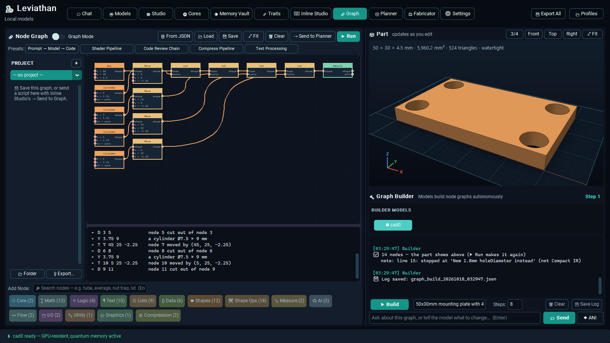</p>
<p align="center"><sub>The result: 50 × 30 × 4.5 mm with four corner holes, watertight — the whole graph on the left, the part on the right.</sub></p>

And a graph is not the end of the line. When one describes a shape, **⇢ Send to Planner** hands it straight to the 3D Planner as a solid part. That is the thread running through these tabs — **code → graph → part** — each handing on to the next.

---

<a name="planner"></a>
### 🔷 Planner

*A real 3D modelling engine, built from scratch — parametric, watertight, and in true-to-life scale.*

<p align="center">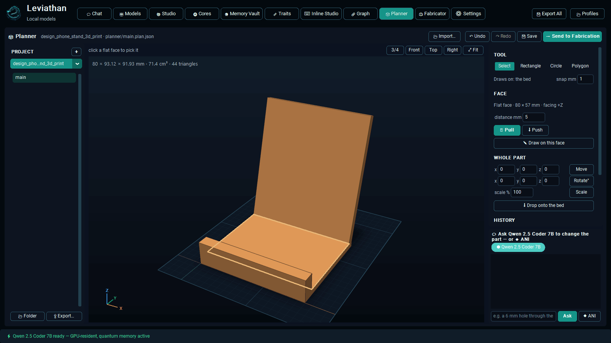</p>
<p align="center"><sub>Real time: the base's top face clicked, then a screw hole asked for in plain words — the model's edit lands as step 2 in the history, and Undo takes it back.</sub></p>

The Planner is not a preview pane or a toy. It is a genuine **parametric CAD engine**, written in-house, where you build a solid part the way an engineer does — a sketch, an extrude, a cut, a pushed face — with every step recorded, so the whole part is a *history* you can walk back through and change. Undo is not a snapshot; it steps back through the real operations that made the part, and the part rebuilds itself from them.

**What makes it serious engineering, not a mesh viewer:**

- **Watertight, manifold geometry.** Every operation produces a *solid* — a closed, manifold mesh with no holes, no self-intersections, nothing that only looks right from one angle. That is the property real CAD and 3D printing demand, and it holds at every step because the geometry kernel *guarantees* it rather than hoping for it.
- **Absolute, real-world scale.** Everything is in **millimetres**, grounded on a build bed at zero. A 40 mm box is 40 mm — not forty arbitrary units. A dimension you type means the same on a tilted face as on the bed, because each face you pick is given its own coordinate frame in the proper CAD convention. What you model is what you could hold.
- **The operations.** **📂 Import…** any 3D file — STL, 3MF, OBJ, PLY, glTF/GLB or FBX — as a solid at its real size (see [Every file gets a blueprint](#blueprint)); sketch a **rectangle, circle or polygon** on any plane and **extrude** or **cut** it; pick a flat face and **push or pull** it (out to add material, in to carve it away); draw directly **on a face**; and **move, rotate, scale** or **drop** the whole part onto the bed. Snap-to-grid in millimetres, keyboard shortcuts, a polygon that closes on its own first corner — the muscle-memory of a real modeller.
- **A GPU-drawn viewport.** The 3D view is rendered on your graphics card, so you orbit, pan and zoom a detailed part at 4K smoothly — the renderer was built for it, not bolted on.
- **The file is yours, and it is open.** A part saves as plain **JSON** — the ordered history of operations, not an opaque blob — so it is readable, diff-able, and never locked to a format only Leviathan understands. It autosaves and keeps backups as you work.
- **It fabricates.** **⇢ Send to Fabrication** writes the part as **3MF and STL** — the formats a 3D printer or slicer actually takes — and opens it in the [Fabricator], which proves it printable before it goes anywhere near a machine.

**And it is driven by more than the mouse.** A graph from the [Graph] tab can be sent in as a solid part — *CAD as code* — and the same pipeline runs the other way too, from Inline Studio's code, to a graph, to a finished part. Model by hand, by node, or by code, all into one engine.

**And by instruction — a model that knows where it is.** Bottom right sits a chat with the model you've picked — shown as chips above it, the same pick Inline Studio and the Graph use, so the model you chose in one tab is the model in the next — or **◆ ANI**, answering from your knowledge banks. The old trap with models and 3D tools is that the model never knows what it's looking at, so it guesses; the Planner hands it the part instead — its real size in millimetres, how it was made, every face and hole measured from the part itself (each with an id, so the model can place a hole, slot or boss just by naming the face, and Leviathan works out the coordinates), and any face you've picked. With a small model, click the face you mean first: asked for a 5 mm screw hole "through the middle of this face" with the base's top picked, Qwen 2.5 Coder 7B got it right 20 times in 20 across two phone stands; asked for the same hole "through the middle of the base" with nothing picked, 10 in 10 on one stand and 2 in 10 on the other — working out *which* face you mean is the hard part for a 7B. Ask *"a 6 mm hole through the middle"* or *"a 10 mm lip around the top"* and the model answers in the CAD library's own language, against the part as it stands — `result = part - cylinder(h=20, d=6).move(40, 30, -1)` — which Leviathan runs in the same locked-down runner as everything else and lands as **one step in the history**: ↶ Undo takes it back. If its script fails, the error goes back to it once to repair; anything outside the safe CAD subset never runs at all; and an answer to a question changes nothing. It works on its own **Token budget** in [Settings].

That closes the loop Leviathan is built around: **you type, a model designs it — in the Graph or right here — it becomes a watertight part, and the [Fabricator] proves it printable and writes the 3MF/STL a printer takes.** When the Fabricator flags something, **✎ Ask the model to fix it** brings the part back here with the findings, and the model's fix arrives as one more undoable step. You say what you want; a model builds it — and then makes it real.

This is early, and it is deliberately ambitious. It already reads six formats and writes four; the plan is to keep widening that until it is a full fabrication suite — built entirely in-house and entirely local, no subscription, no cloud project store, no account, the parts you make kept as files on your own disk in a format you can read. It is a foundation laid to grow, and it will.

---

<a name="fabricator"></a>
### 🔷 Fabricator

*Prove it printable — then hand it to your slicer.*

<p align="center">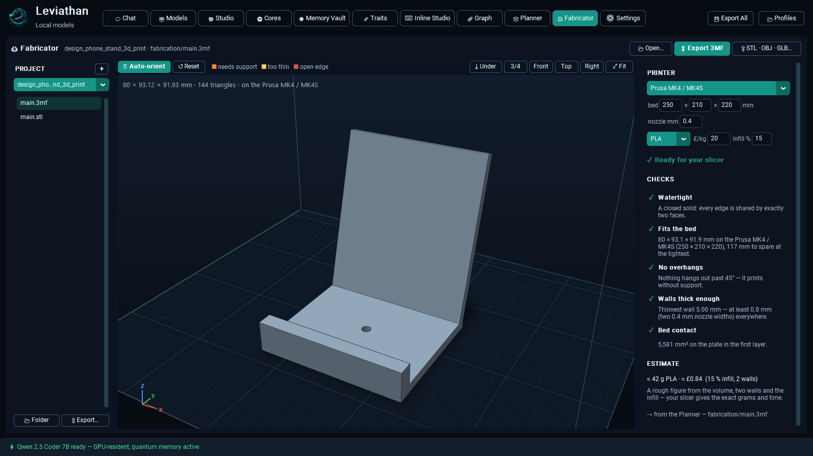</p>
<p align="center"><sub>Watertight, fits the bed, no overhangs, walls thick enough, real contact with the plate — and a rough cost in filament.</sub></p>

The last step from idea to object. A failed print usually announces itself six hours and a spool of filament too late; the Fabricator catches it before the first layer. A part arrives from the [Planner] (⇢ Send to Fabrication opens it here), from the PROJECT column, or from anywhere on your disk with **📂 Open…** — any 3D file: STL, 3MF, OBJ, PLY, glTF/GLB or FBX, read at its real size by its [blueprint](#blueprint) — so it checks the model you just downloaded, too, without copying it anywhere.

The part sits on **your printer's real build plate**, with the build volume drawn around it. Pick your printer from the list (Prusa, Bambu Lab, Creality, Elegoo, Voron and more, by their published build volumes) or type your own bed size, nozzle, material, price per kilo and infill. Leviathan remembers your printer. Then every check runs on the mesh itself:

- **Watertight** — every edge shared by exactly two faces, wound consistently, nothing inside out. Planner parts are closed by construction; a mesh from elsewhere gets its holes and flipped faces counted.
- **Fits the bed** — the part's size against your build volume, by how much it's over if it is, and whether a quarter turn would fit it.
- **Overhangs** — any underside steeper than 45° needs support. These faces always point downward, so a part that has them opens **seen from below**, where you can see them; **⤓ Under** gets you back there any time.
- **Walls** — the thickness of every wall, measured by a ray cast straight through to the opposite side. Thinner than two nozzle widths prints as a single, weak line; thinner than one may not print at all.
- **Bed contact** — the real footprint of the first layer, measured as a cross-section just above the plate rather than guessed from "flat" faces. Nothing to grip is an error; too tall for its footprint wants a brim. And if a big flat underside sits a hair above the lowest point — a rotated piece's corner poking below the base is the classic — it says so, by how much, and what to trim.
- **Estimate** — roughly how many grams of filament and what they cost, from the volume, two walls and your infill. Your slicer gives the exact figure.

Problem faces are tinted right on the part — **orange** needs support, **yellow** is too thin, **red** is an open or flipped edge — and a verdict sits on top: *ready for your slicer*, *printable — mind the warnings*, or *not ready*. **⟲ Auto-orient** turns the part for the least support (then the most bed contact, then the lowest height, and a quarter turn if that's what it takes to fit), **↺ Reset** puts it back, and **⇪ Export** writes it the way it's turned: **3MF / STL** for your slicer, **OBJ** in millimetres, or **GLB** in metres, Y up — glTF's own convention, so Blender, Unity and Godot open it at its real size. And when a Planner part is flagged, **✎ Ask the model to fix it** takes it back to the [Planner] with the Fabricator's findings for your model to fix — one undoable step — ready to send back and check again.

**What it deliberately is not: a slicer.** Slicers are decades of craft and you already own one; the Fabricator's job is to make sure what you hand it will work. Nothing in it touches the network. Every check runs on your machine — in moments for a typical part, a few seconds for a huge downloaded mesh — on a worker thread, so the window never freezes while it works.

<a name="blueprint"></a>
#### 🔹 Every file gets a blueprint

Moving a 3D file between programs is where real-world size usually dies. STL, OBJ and PLY carry **no units at all**, so a part drawn in inches lands 25.4× too small, a Blender export in metres arrives as a speck, and a Y-up file turns up lying on its back. Leviathan reads a mesh the way it reads a model — **blueprint first**. Before anything comes over, it names the format from the file's own bytes (never trusting the extension), reads the body exactly as stored — every part placed by its own transforms — and notes what the file *declares* against what the body *is*:

- **Declared** — glTF is metres and Y up by definition; a 3MF states its unit; an FBX records its unit scale, its axis system and the program that wrote it. Those are read, not guessed.
- **Not declared** — for STL, OBJ and PLY it weighs the evidence: how big the object would be in each unit, and whether its design dimensions — the gaps between its flat faces — come out as round numbers in one of them (a metric part saved in inches gives itself away). It says how sure it is, and when the evidence is genuinely split it says so and names the runner-up rather than guessing with confidence.

Then the differences are applied automatically — millimetres, Z up, on the bed — and listed. In the Fabricator the **FILE** panel shows the blueprint with **Units** and **Up** switches, so a file that didn't say can be put right in one click without being read again; the Planner asks once, and only when a file's units are honestly ambiguous. It reads STL, 3MF, OBJ, PLY, glTF/GLB and FBX 7 (2011 on, binary or text). Nothing is ever fetched: a glTF that points at the web or outside its own folder is refused, and so are Draco- or meshopt-compressed meshes (export without compression).

The readers are Leviathan's own — no extra library in the build — and checked against independent ones on files from real exporters: FBX against three.js's own FBXLoader (Blender, Maya and Mixamo files, binary and text), OBJ, PLY, STL and glTF against trimesh. Same triangles, same placement, same surface area.

---

<a name="settings"></a>
### 🔷 Settings

<p align="center">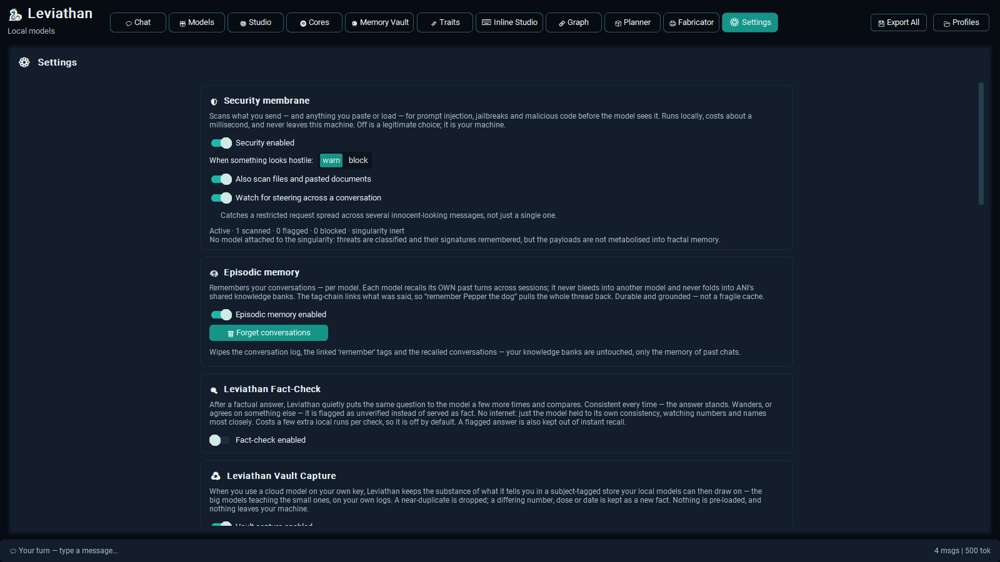</p>

One scrollable tab holding every switch and dial in Leviathan, grouped by what it governs. Nothing here needs a restart — a change takes effect on your next message, and every one is remembered between runs. (The one control that *used* to live here, reasoning depth, now sits by the chat box instead — see [Chat] and [Reasoning layer].)

Here is everything you will find, top to bottom:

**🔹 Security membrane** — scans what you send, and anything you paste or load, before the model sees it. [Below].

- **Security enabled** — the master switch. Off is a legitimate choice; it is your machine.
- **When something looks hostile: warn / block** — flagged with an explanation, or stopped outright.
- **Also scan files and pasted documents** — extends scanning beyond what you type to what you drop in.
- **Watch for steering across a conversation** — catches a restricted request spread across several innocent-looking messages, not just a single one.

**🔹 Knowledge routing (ANI)** — the knowledge engine, and the one optional door to the web. See [Knowledge routing].

- **Knowledge routing enabled** — on by default; only fires when a bank actually holds something that fits the question.
- **🗣 ANI background voice** — on by default. ANI speaks through your loaded chat model for free; with nothing loaded she can *also* use a small model of yours, set in the field below it, as her voice — freed the instant you mount a model. Off → she speaks only through your loaded model, else plain text. See [Knowledge routing] → *How ANI speaks*.
- **🌐 Web lookup when ANI has no answer** — off by default. The one door out: on a gap it sends *only* your question to be answered, gates the result, and keeps it local for next time ([the one door out] explains it in full).
- **Web source** — the default is **Wikipedia**: keyless, free, no signup, and only `en.wikipedia.org` ever sees your question — ideal for *what-is-X* facts, which the local binder phrases into a grounded answer. Two optional keys layer on top, tried first and falling back to Wikipedia:
  - **Tavily key** — optional, genuinely free tier (sign up at tavily.com). A search built for LLMs that returns a *direct answer*, so it handles **premise** questions Wikipedia can't — ask "the capital of the Moon" and it comes back with "the Moon has no capital," which ANI then grounds and stores. Only `api.tavily.com` sees the question.
  - **Gemini key** — optional, and only useful on a *paid* Gemini plan (Google moved search-grounding behind billing). With a paid key it returns a composed, live-search-grounded answer, sent only to Google.
  - Whichever source answers, the result is membrane-gated, grounded (ANI only states what the source said), and kept local for next time.
- **🗂 Defragment** — ANI's housekeeping, and worth understanding. Absorbed knowledge lands first in a staging pen, kept *out* of answers until it is sorted; **Defragment now** re-classifies each waiting item on your GPU into the subject bank it truly belongs to (or *conversations* for pure chatter). Run it when the waiting count grows — it is how ANI stays tidy and sharp as the vault fills, and how nothing un-sorted ever leaks into a knowledge answer. The librarian sorts the shelves after hours. (Absorbing *into* ANI now lives in **Studio → Absorb → ANI**, and takes code and datasets only — never loose documents.)

**🔹 Episodic memory** — your conversations, remembered *per model*. Each model recalls its own past turns across sessions, and the tag-chain links them so *"remember Pepper the dog"* pulls the whole thread back. A model's episodic memory is its own — it never bleeds into another model, and it never folds into ANI's shared banks. On by default; **🗑 Forget conversations** wipes it. [Below].

**🔹 Leviathan Fact‑Check** — after a factual answer, re-asks the model the same thing a few times and flags it if the retellings disagree. Off by default (it costs a few extra local runs). [Below].

**🔹 Leviathan Vault Capture** — keeps the substance of what a cloud model tells you, on your own key, on your machine, so your local models can draw on it later. On by default. See [Recycling cloud answers].

**🔹 Server for other programs** — lets a game engine, a script, or any other program on this machine use the models Leviathan runs, over a local HTTP endpoint (127.0.0.1:8080, OpenAI-compatible *and* Leviathan-native). Flip on to start, off to stop. [Using Leviathan from other programs].

**🔹 Token budget** — how much a model may write in **one reply**, set per surface: **Chat**, **Inline Studio**, the **Graph** and the **Planner** — each a place a model actually writes. A slider from **512** up to **∞**. This is *reply* length, and it is separate from context length: a big context does not make replies longer, this slider does. **∞ means no cap at all — not even the context window.** A reply that reaches the end of the window keeps going: your instructions and your question stay in view, the newest part of what the model has written stays with them, and so do the older lines it keeps going back to. For the last few words before the window fills, Leviathan notes where the model's attention goes, and each attention head keeps the earlier lines it was reading: a function defined at the top of a long file, a name the reply keeps using. The rest slides out, so the model never runs past the positions it was trained on and never slows down. Tested on a 7B with a 2,048-token window: a 6,000-token reply counted from 1 to 1,421 without missing a number across five slides, at full speed. Measured against the same 7B holding the whole reply at once, keeping those lines brought its next-word predictions 57 % closer on a long code file, 55 % closer on a long program it wrote itself and 48 % closer on this README, and 3 % closer on its own free prose. Models under about 2B parameters keep a quarter of those lines this way rather than half: on a 0.5B, half cost its own prose. What it can't keep is a detail the reply never looks back at, such as a number mentioned once at the start and not again: that slides out, as before. A reply that falls into repeating itself once it's past the window is stopped, and the **■** beside the chat box (or **Esc**) stops any reply part-way, keeping what it wrote.

**🔹 Context length** — the model's **single-pass window**: how big one prompt can be (system prompt + any project files + any ANI reference + its memory + your message) and the range its positions cover. From **2048** up to **Max** — the model's own full trained window, costing more VRAM the higher you go, bounded by your card and not by us. A model's memory reads back into this window — its newest turns, up to a quarter of it — so a bigger window lets a model read back more of what you said, at the price of slower turns once a conversation fills it; everything older stays in its memory on disk, where episodic memory can find it. Raise it when a single prompt is genuinely large, such as Inline Studio with ANI, or for a longer read-back. It was silently pinned at 2048 before; now it is yours. Takes effect the next time a model is loaded.

**🔹 Faster replies** — lets a small *helper model* write ahead while your model checks its guesses several at a time, so replies arrive sooner and say exactly what they would have said anyway. Switch on **Use a helper model to speed up replies** and pick the helper: the list shows the small models in your model folders, or **Browse…** to one. It must come from the same family as the model you chat with — for any Qwen 2.5 model, that's Qwen 2.5 Coder 0.5B. The line under the switch tells you, for each loaded model, whether the helper is working for it, and if not, why. Off by default. [Below].

**🔹 Memory** — where each model's memory is kept, with **📂 Open folder** to go there and **🧠 Read it in Studio** to look inside; how it works is covered under [Persistent memory]. There is nothing to tune: memory is text, it is written as you chat, and how much a model reads back follows **Context length**.

**🔹 Appearance** — your own colour for Leviathan's frame. Pick it with **R / G / B sliders** or a preset, see it in a preview, and **Apply** repaints the window on the spot; it's remembered next time. Only the frame changes — the window, panels, fields and borders. Buttons, the accent colour and your work (graphs, 3D views, code) keep their own colours, and every panel keeps exactly the brightness it has now, so text stays just as readable whatever colour you choose. **Deep sea** puts the original look back. A **Window opacity** slider makes the whole window see-through, down to half.

**🔹 Chat text** — a font of your own for your messages and another for the replies, so the two read apart at a glance. Pick the **font**, **size** and **style** (regular, bold or italic) for each side, or start from a preset — **Clean**, **Book**, **Typewriter** or **Handwritten**. A preview shows the result as you go, the chat changes on the spot, and it's remembered next time. Code inside a message keeps a fixed-width font, so it still lines up. **As designed** puts the original font back. (The chat pictures in this README show replies in **Comic Sans MS**, size **15**, **italic**.)

**🔹 This machine** — what Leviathan found: your graphics card, and the exact folder your data is being written to.

**🔹 About** — author, copyright, licence, and buttons through to the GitHub repository, the Zenodo whitepaper archive, and the full licence text.

*(Encryption for your knowledge is not here — it lives on its own tab, as a single padlock. See [Memory Vault].)*

---

<a name="the-systems"></a>
## 🔷 The systems

The tabs above are the surfaces — what you open, click and type into. These are the systems running *underneath* them: the machinery that gives a model a memory that lasts, knowledge it can reach for, answers held to their own honesty, and a guard on everything that comes in. You never open these directly; they are what the tabs are *for*.

---

<a name="persistent-memory"></a>
### 🔶 Persistent memory

**The problem.** Every chat with a local model normally starts from nothing. Close the window and the model has never met you. The usual workaround is to paste a summary of yourself at the start of every conversation, which is tedious, eats your context window, and is a poor imitation of remembering.

**What Leviathan does instead.** Everything you and a model say to each other is kept, as text, in that model's own memory. Before it answers, the model reads back its newest turns with you, in order, so it picks up where you left off. The model resumes rather than restarts. (How the memory is kept, and why as text rather than the model's internal state, is under [The two file types].)

**What that means in practice:**

- You do not re-introduce yourself.
- What you said recently is there when you come back: the model reads back its newest turns before every reply, up to a quarter of its context length.
- Older turns aren't lost. They stay in the memory, on disk, and [episodic memory](#episodic-memory) brings one back when your question's words match it.
- It is your conversation, word for word: readable, searchable, and yours to delete or export in **Studio → Inspect memory**.
- It costs a share of the context window — a quarter at most — and some time: with a full read-back a reply starts about 1.4 seconds later and writes about a tenth slower (a 7B on an RTX 4080). Nothing stays in graphics memory between turns.
- What it keeps is the *substance of the exchange* — your messages and its answers. The invisible scaffolding Leviathan wraps around each turn (the reasoning nudges, the safety checks, the context it assembles for that one reply) steers the answer and is then left out of the memory. A reply that came out garbled isn't kept at all.

**Talking to several models.** A chat with two or more models, and a [Knowledge Route], go into each model's MPM, not its PMB: each one keeps that conversation from its own side, with every line marked by who said it, and reads it back when the same models talk again. Its PMB stays just you and it.

**When it saves.** Every exchange, the moment the reply lands. No button. Each one is written as a single transaction, so a crash or power cut mid-write leaves the memory as it was, never half-written.

**Where it lives.** One file per model — `<model>.<name>.mem` in the `memory_banks` folder of your Leviathan data folder (**Settings → Memory** opens it). Deleting it resets that model to a blank slate; copying it elsewhere backs up that memory. Rename a model in Models and its memory goes with it.

**Each tab keeps its own headspace.** The model reads back its memory of you in [Chat]; [Inline Studio], the [Graph] and the [Planner] each keep their own working memory for the job in hand. Set a model coding a clock in Inline Studio, then switch to Chat and ask it for a story, and it starts the story fresh rather than dragging the coding task across — while still remembering your chats.

**Checking it works.** [🧿 Cores] shows every model's memory: how many turns, when it was last used, how much it reads back. **Memory Vault** counts every model's lines, and **Studio → Inspect memory** shows every one.

---

<a name="knowledge-routing"></a>
### 🔶 Knowledge routing — ANI

**The problem.** A model knows what it was trained on. It does not know your rulebook, your codebase, your company's processes or your world's history. The usual fix is to paste the relevant document into the chat, which means knowing in advance which document is relevant and having room for it.

**What Leviathan does instead.** You build knowledge banks, and each one is *text* — knowledge drained out of a model before you retire it, consumed from a document or a recording, or written by hand. ANI, the router, projects every bank and every question you ask into **one shared space**, where nearness means relatedness of *meaning*. Ask something and it finds the knowledge that actually fits — across all your banks at once — and hands it to the model before it answers. You never file the question under a subject or pick a bank from a list; the geometry does that for you.

**What that means in practice:**

- It reads meaning, not spelling. "symptoms" finds material stored as "symptom", "debugging" finds "debug" — the match is in the shared space, not in the letters.
- Because a bank is text, it is free of any one model. Drain the knowledge out of a big model that is about to be replaced, and a small model can answer from it — no retraining, no matching architectures, no shared vocabulary required. Knowledge crosses between models as **text**, carried by meaning, not by transplanting weights.
- The strongest bank wins and a weak one loses, on the same question, by relevance alone — so quality beats quantity. A bank is only ever as good as what went into it; a vague source makes a vague bank, and the router will faithfully surface exactly that.
- Banks grow. Consume the same knowledge twice and the duplicate is dropped; add something new and it accretes. The space reshapes itself as the substrate grows.

**How ANI speaks — her voice.** ANI *finds* the right knowledge, but reading it back as a fluent answer needs a small generator to phrase it — a voice. Here is the honest shape of it, because it's the question most people ask first ("why is there a model in settings — why not just use my own?"):

- **ANI uses your own loaded model.** When you have a chat model mounted, ANI speaks through *it* — for free, no extra memory. Your model is her voice. That is the normal case, and it's exactly what you'd expect.
- **A small model of yours can stand in when nothing is loaded.** Leviathan ships no model of its own; you bring yours. So that ANI can still answer when you *haven't* mounted a chat model, you can point **Settings → ANI → ANI binder** at a small `.lev` of your own (a 1B ~1 GB or a 3B ~2 GB is plenty), and it becomes her voice in that moment. **The instant you load a chat model, that binder is freed** — it never sits alongside yours competing for VRAM, and it never overrides your model. It's a backup voice, not a second brain.
- **It only ever phrases.** The binder speaks *only* from the knowledge ANI retrieved, held to it by a grounding check: a reply that strays from what she found is dropped, and you get the retrieved text instead. The knowledge is ANI's; the binder just gives it a mouth.
- **Entirely optional, and off-switchable.** Leave the binder field blank and nothing extra ever loads. And **Settings → ANI → ANI background voice** turns the whole thing off: ANI then speaks only through your loaded model, or hands back the retrieved knowledge as plain text. ANI itself stays on either way — this only ever decides her *voice*, never whether she works.

**Filling a bank — local, every time.** You fill banks in **Studio → Absorb → ANI**, and each one folds in the background — deduplicated so nothing is stored twice, coherence-checked so degenerate or repetitive text never makes it in, and backed up as `.jsonl`. Every path runs on your own machine with nothing sent anywhere. Two kinds of source, both *vetted* on the way in:

- **A model, drained.** A model talks out what it knows and Leviathan keeps only what it is genuinely confident of — the knowledge a retired model spent its whole training absorbing, lifted into text before the weights are gone. *Dead models become donors.*
- **Your own code.** Source files, and instruction+code *datasets* (parquet or JSONL) — where every function is **compiled and run before it is kept**, so a code bank holds only patterns that actually work. Code is the one thing a machine can truly verify, and verifying is the whole point.

**Loose documents are deliberately not absorbed.** PDFs, Word files, web pages, recordings, chat logs — none of them go into the shared banks. ANI's knowledge layer takes only what can be *vetted*: a model's own confident knowledge, or code that compiles and runs. Unverified prose is exactly what would quietly poison what every model then reads, so the door is simply shut — a deliberate design choice, not a missing feature. (An answer a cloud model gives you on your own key is a separate, automatic path, and it is kept — see [Recycling cloud answers].)

What lands here goes into the same shared space and is answerable, by any model you load, next week or next year — even when the model that could first have told you is long gone. It is opt-in and deliberate every time: nothing is captured unless you ask for it, and nothing ever leaves your machine.

**Seeing it happen — the Route panel.** Beside the chat, the **🔀 Route** panel keeps a running log of where your questions went. Each time a model answers, a new entry appears at the top: the model that replied, the knowledge bank it drew on, the subjects the question matched, and how many tokens and milliseconds it took. Newest on top, older ones beneath, so at a glance you can see which banks are actually being used — and which never get picked, which usually means a bank whose tags don't match the way you ask. The list keeps the last thirty or so routes; when you want a clean slate, the **🧹 Clear Route** button in the bottom-right of the panel wipes it. It clears only the on-screen log — your banks, memories and models are untouched.

**Clicking a subject.** The subjects on a route entry are not just labels. Click one and a small panel opens with the topics filed under it — click *science* and you get physics, astronomy, chemistry and the rest; click a topic and you get the subject it belongs to. It is the same map Leviathan routes by, laid open, so you can see exactly why a question landed where it did, and spot a bank that is filed too broadly or too narrowly to be found the way you ask.

**A second opinion, in a different currency.** Beneath each entry sits a 🧠 line: an independent guess at which bank fits, made not from the *words* you typed but from their *meaning*, placed in the model's own embedding space. It agrees with the tag routing most of the time; when it disagrees, that gap is the useful part — usually a bank whose name and tags don't describe what it actually holds. It is shown for your eyes only, and never changes where the knowledge really came from.

---

<a name="reasoning-layer"></a>
### 🔶 Reasoning layer

**The problem.** A small local model tends to answer from the first thing that looks right. Ask it something that needs working through — a calculation, a proof, a piece of code, a chain of logic — and it will often blurt a plausible-looking answer without ever doing the steps. The deliberate thinking a larger model would do simply doesn't happen.

**What Leviathan does instead.** Leviathan is the host; the model is a guest. Before the model answers, Leviathan reaches into a library of real reasoning traces — how a frontier model actually worked through problems of that kind — finds the closest one, and hands the guest its structure: *approach it like this, in these steps, and show your working before you commit.* The model still writes its own answer, in its own voice, from its own knowledge — it is simply walked through the *shape* of the reasoning instead of being left to guess at it. A model that reasons poorly on its own is given the scaffolding to try; a model that reasons well is pushed to do it properly.

**It costs nothing extra.** This is a single pass. Leviathan does not run the model several times or spend anything on a reasoning answer — it simply gives the one answer more to work from.

**Four depths, or let it decide.** A compact **🧠** selector sits right by the chat box — no digging through Settings — where you choose how hard the model is pushed: **Light**, **Medium**, **Heavy**, **Max**, from a brief nudge to a full multi-step template with an explicit instruction to check its work and verify before answering. Depth here means *thoroughness of the answer*, not a token bill. Or leave it on **Auto** — where it starts — and Leviathan reads each question for itself. It weighs not only *what* you ask — a quick factual query stays light, a *"derive this from first principles and compare it, step by step"* climbs to Max — but *how* you ask it: lean on the message the way people do when there's more behind it than the words say (capitals, an urgent tone, a trailing "…") and it leans back, raising the depth the way a raised voice would. **Off** turns the whole thing off — worth having, since a model that only ever generates freeform text may not want a scaffold at all.

**Match the depth to your model — the selector shows you how.** The scaffold has to suit the size of the model carrying it: too much structure for too small a model overwhelms it and the answer falls apart, so depth scales with parameters. The selector puts the guide right next to each mode — a size marker telling you the smallest model that handles that depth well:

| Depth | Best for | What happens |
|---|---|---|
| **Off** | any model — and the *only* safe setting for a **1B** | a 1B has no room for a scaffold; reasoning collapses it, so it runs clean on its own |
| **Light · 7B only** | **7B** only | a gentle nudge; a 7B handles this well and writes genuinely better |
| **Medium · 14B+** | **14B** and up | a fuller scaffold; a 14B produces complex, coherent, well-structured answers |
| **Heavy · 32B+** | **32B** and up | a deep multi-step template |
| **Max · 70B+** | **70B** and up | the fullest push, check-your-work-and-verify |

A bigger model can use a *lower* mode safely — it just under-uses the room, which is why Light is marked for the 7B alone. A *smaller* model on a mode above its marker would go wrong fast, so Leviathan doesn't let it: **every model is locked to the depths its size can carry** — a 7B never goes past Light and a 1B runs Off, whatever the selector says, and the status bar tells you when a pick is held back. (The size comes from the model's name, its file name, or failing both its own weights.) The 1B/7B/14B rows are measured on real models; 32B and 70B follow the same doubling pattern and are the recommended starting points rather than tested results — tune to taste. **Auto**, the default, is safe on any size for the same reason: a hard question can pull a 70B all the way to Max, while the same question gives a 7B Light.

**In a chat between models, each model is capped on its own.** Pick Light with a 7B and a 1B loaded together and the 7B gets Light while the 1B runs without a scaffold. The chat opens with a line saying exactly what each model gets, and hovering the 🧠 selector shows the same for whatever is loaded. (The Knowledge Route doesn't use the selector at all: its asker and answerer get the Route's own prompts.)

**It feeds the routing, too.** What the reasoning layer works out a question is *about* also nudges [knowledge routing] — a coding question leans the router a little further toward your coding banks — but only ever as a gentle reinforcement added on top, never overriding where the knowledge actually comes from.

**Where the reasoning comes from.** The library is distilled from real traces of a frontier model reasoning through tens of thousands of problems — coding, mathematics, the sciences, medicine, law and more. It is *text* — worked examples — not anyone's weights, and none of it changes what your model *is*. It only changes how your model is asked to think. It is fed only from **vetted** sources — licensed reasoning traces, and code examples that were compiled and run before being kept — never scraped from your own chats, so a stray conversation can never quietly reshape how every model reasons.

---

<a name="forensic-grid"></a>
### 🔶 Forensic Grid

*Structural vision for models that have none.*

**The problem.** A local model — a small one especially — usually cannot see an image at all. It has no visual eye, and the models that do are fussy about format and often can't run on your own GPU. So a diagram, a scan, a plot, a screenshot is simply outside the conversation: you describe it in words, or you go without.

**What Leviathan does instead.** It does not try to teach your model to recognise pixels. It reads the *structure* of the image with the grid — the same structure-reading mathematics the rest of Leviathan is built on — and hands the model a short, plain-language readout of what is there: where the bright mass sits, what shape it takes (a compact **blob**, a line or **ridge**, **layered** bands, or **diffuse** with no clear form), which way it runs, and whether there is real structure at all or just noise. The grid does the seeing; the model reads what it saw and reasons about it.

**How you use it.** In the panel beside the chat, turn **🔬 Forensic Grid** on, press the **microscope** beside its switch, and pick a file. Leviathan reads its structure, tells you plainly what it found — *"blob, lower-right"* — and attaches that readout to your **next message** on its own. You just ask your question about the image. One toggle, one button, nothing to configure. Off by default, because it is yours to switch on when you want it.

**What it is, and what it is not — so you know what to expect.** This is *structural* sight, not object recognition. It will tell a model that an image has a compact bright region in the lower-right, a diagonal ridge across it, or eight layered bands — it will **not** tell it "that's a photo of a dog" or read the words on a sign. Where structure *is* the content — diagrams, plots, charts, scans, microscopy, scientific and medical images, anything where *where things are and what shape they make* is the point — that is exactly what it delivers, on any capable model, with no visual training and nothing sent off your machine. For a caption of a holiday snap it is the wrong tool, and it will show you that honestly by describing shape rather than subject.

**It reads better on a stronger model.** The model has to *understand* the readout, so a good instruction-follower makes full use of it while a very small or weak model may not — another reason it is a toggle you control rather than something always on. Images now; the same idea extends naturally to the pages of a document, which is where it is headed next.

---

<a name="surface-sight"></a>
### 🔶 Surface Sight

*Actual image recognition, run as a tool the engine never has to become.*

**The other half of seeing.** Forensic Grid reads an image's *structure*; Surface Sight reads its *surface* — what the picture actually **depicts**. Point it at a photo and it tells the model *"a cake"*, *"an office"*, *"a street"*, *"a mountain"* — the kind of recognition a vision model or a coding assistant gives you, now available to a local text model that has no eye of its own.

**How it stays true to Leviathan.** Recognition comes from a trained vision model, and those live in weights that are far too heavy to bake into a lean, driver-only engine. So Leviathan does not bake them in. The recogniser runs as an **external tool** — a small, self-contained vision model on your **CPU** (no special graphics card, works on any machine, nothing sent off it) — and simply hands the words it found back into the chat. The engine that runs your language model never changes; it just gets told what the picture shows, the same way Forensic Grid tells it the shape.

**How you use it.** In the panel beside the chat, turn **🔎 Surface Sight** on, press the **gridded picture** beside its switch, and pick a file. It recognises the content, attaches a short readout — *"most likely a cake (99%)"* — to your **next message**, and you ask your question about the image. One toggle, one button, off by default.

**Honest about confidence.** It tells you *how sure it is*, and when it is not sure it says so and offers its best few guesses rather than bluffing a single answer. It is strong on clear subjects and honest about the fuzzy ones — you will always see the number, so you always know how much to trust it.

**The vision add-on — bundled, local, optional.** The recogniser is an **optional component you choose at install time** — tick it or leave it, your call. When you tick it, the whole model ships **inside the installer** and installs locally; it is **never downloaded at runtime** and never phones home, so Surface Sight holds to the same web-free floor as the rest of Leviathan. Leave it out and the button is still there — it simply tells you the component isn't installed. Forensic Grid (structure) needs nothing extra and works out of the box; Surface Sight (recognition) is the opt-in companion for when you want the model to know *what*, not just *where*.

---

<a name="recycling-cloud-answers"></a>
### 🔶 Recycling cloud answers

Connect a cloud model — your own account, your own key — and Leviathan quietly keeps the substance of what it tells you. Ask Claude or Grok or Gemini something on your machine, and the answer is folded into a subject-tagged store your *local* models can then route against, exactly like a bank you built by hand. Over time the big models teach the small ones, on your own logs, without you doing a thing.

It is careful about what it keeps. A near-duplicate of something already there is dropped rather than stored twice — but two answers that differ by a single number, a dose or a date or a version, are both kept, because a different figure is a different fact and not a repeat. Nothing is ever pre-loaded, and nothing leaves your disk: it is your conversations, under your key, on your machine. On by default; switch **Leviathan Vault Capture** off in [Settings] (or `NEXUS_VAULT_CAPTURE=0`).

---

<a name="episodic-memory"></a>
### 🔶 Episodic memory

A model in Leviathan remembers your conversations — and that memory is **its own**. Each model keeps a running episodic record of what *it* discussed with you, recalled across sessions, so you can pick a thread back up weeks later and it knows what you meant. It finds past turns by the words in your question, so "what's my sister called?" finds the turn where you said "my sister's name is…"; a question that shares no word with the old turn won't find it. Measured on a 7B model: ten facts planted, then pushed out of the model's working memory by later conversation, then asked after a restart. Episodic memory brought back all ten. (The memory format Leviathan used before, the `.fqm`, brought back one on its own — the same as no memory at all, and one reason memory is kept as text now.)

**Per model, by design.** A model recalls only its *own* past turns — never another model's. This matters more than it sounds: pooling chat memory across models is how you end up with a model answering in a voice, and with "memories", that were never its own — a split personality that reads as hallucination. So the memory is kept strictly per model, and it never folds into ANI's shared knowledge banks either. Your episodic history steers the model that lived it, and nothing else.

**Linked recall.** It is not just the last few messages. A tag-chain links what was said, so a later *"remember Pepper the dog?"* pulls the whole earlier thread back into view, not only the sentence that happened to match. Memory that connects, rather than a flat scrollback.

**Durable, not a cache.** This is a real record of your chats, written down and reloaded — not a fragile shortcut. (It replaces an earlier exact-match answer cache called *Eidetic recall*, now retired: returning a saved answer only ever worked when a question was repeated word for word, and anything looser risked serving a confident answer to a question you never asked.)

On by default. **🗑 Forget conversations** in [Settings] wipes the log, the linked tags and the recalled conversations in one step — your knowledge banks left untouched, only the memory of past chats gone. You can switch it off there, too.

---

<a name="second-opinion-fact-check"></a>
### 🔶 Second-opinion fact-check

A local model asked something it does not truly know will often answer anyway — confidently, and differently each time you ask. Leviathan can turn that against it. Switch the check on and, after a factual answer, it quietly puts the same question a few more times and compares: say the same thing every time and the answer stands; wander between retellings — or agree on something *other* than what you were first told — and the answer is flagged as unverified rather than served as fact.

No internet, no outside reference: it only asks the model to be consistent with itself, which is exactly where an invented fact comes apart. It watches numbers and names most closely, since that is where a wrong answer usually hides. Because it costs a few extra runs of the model, it is off by default — turn **Leviathan Fact‑Check** on in [Settings] (or `NEXUS_FACTCHECK=1`). A flagged answer is also kept out of Leviathan's answer cache, so a shaky reply is never served back later as though it were verified.

---

<a name="any-model-described-by-itself"></a>
### 🔶 Any model, described by itself

Leviathan ships knowing a handful of models in detail. Load one it has never seen — your own, converted yourself — and rather than guess at its shape, it reads the model's own interior at load time and writes down what it finds: how many layers there are, how attention and the feed-forward are built, where every tensor goes. That description is saved beside your data, so the second time you load that model the reading is already done, and you are left with a plain, honest record of exactly how Leviathan is treating it. Change the model and the description is rebuilt to match.

---

<a name="faster-replies"></a>
### 🔶 Faster replies — a helper model

*Same answers, sooner. If you've met the term before, this is* speculative decoding.

**The problem.** A model writes its reply one token at a time. (A token is a word or a piece of one; "photosynthesis" takes a few.) For every single token, your graphics card reads very nearly the *entire model* out of its memory: about 7 GB for a 7B model at Q8_0, start to finish, for one token. That reading is the speed limit. The card's maths units spend most of their time waiting on it, which is why a reply streams out at the same steady pace whether the next word is "the" or "photosynthesis".

**What Leviathan does instead.** It pairs your model with a *helper*: a much smaller model from the same family, about a twelfth of the size. The helper has so little to read that it can guess the next few tokens in a fraction of the time. Your model then checks all of those guesses in a single pass, and checking four tokens costs it not much more than writing one, because the expensive part (reading the model out of memory) happens once either way.

Your model keeps every guess it agrees with, up to the first one it doesn't. There it writes its own token instead, and the helper carries on guessing from that point. A good run of guesses gives you four tokens for little more than the price of one. A wrong guess costs a moment and nothing else, because your model was going to write that token anyway.

Think of an apprentice and a master. The apprentice sketches the next few strokes; the master glances over them, keeps what's right and redraws the first one that isn't. The master never has to redraw what the apprentice got right, but every line on the page is one the master approved.

**Why your answers don't change.** The helper only ever suggests. Your model still decides every token, so what you read is your model's reply, not the helper's.

- **At temperature 0** (no randomness), the reply comes out the same, token for token, with the switch on or off. In our tests it was identical every time, in every format below. Strictly speaking, checking several tokens at once adds the numbers up in a slightly different order, so a near-perfect tie between two words could in principle tip the other way, just as it can between two different graphics cards. We haven't seen it happen.
- **With creativity turned up** (temperature above 0; Leviathan's default is 0.7), your model's reply is a fresh random draw every time anyway. Leviathan keeps the odds *exactly* as your model would set them: each guess is kept with precisely the chance your model gives it, and when one is turned down, your model draws its own token from the chances that are left. You get the same kind of answer, with the same variety, sooner. This is the standard, proven method, published in 2023 by Yaniv Leviathan, Matan Kalman and Yossi Matias at Google and, independently, by Charlie Chen and colleagues at DeepMind. (The surname is a coincidence. Honestly.)
- **Your memory stays clean.** A model's memory is written from the reply you were given, once it has landed, so a guess your model turned down never reaches it.

**What you need.**

- **A helper from the same family as your model.** The two compare guesses token by token, so they must split text into tokens in exactly the same way: the same *tokenizer*, the dictionary that turns text into tokens. In practice that means the same family and generation:
  - for any **Qwen 2.5** model (any size, Coder or not): **Qwen 2.5 Coder 0.5B**, 0.6 GB at Q8_0, the helper we measured with;
  - for **Llama 3.1, 3.2 and 3.3** models: **Llama 3.2 1B** is the usual choice.

  Leviathan checks that the two match before it uses them, and tells you plainly if they don't. It also turns down a helper that isn't much smaller than your model (more than 40% of its size), because then it couldn't be faster.
- **About 1 GB of spare graphics memory** for the helper: 0.9 GB with a 4K context window, up to 1.6 GB at 32K, because the helper keeps its own copy of the conversation so far.
- **Settings → Faster replies:** switch on **Use a helper model to speed up replies** and choose the helper.

**How much faster.** That depends on how predictable the reply is (the helper guesses code, lists and plain explanations well, freewheeling fiction less well) and on your graphics card. Measured on our RTX 4080 with Qwen 2.5 Coder 7B and the 0.5B helper, on six everyday requests (a Python class, a shell script, three explanations and a haiku). At temperature 0, every reply was identical to the one written without the helper:

| Your model's file | Temperature 0.7 (the default) | Temperature 0 |
|---|---|---|
| Q8_0 | 70 → 112 tokens a second (**1.59×**) | 72 → 123 (**1.71×**) |
| Q6_K | 88 → 117 (**1.34×**) | 91 → 136 (**1.50×**) |
| Q5_K_M | 94 → 120 (**1.27×**) | 97 → 128 (**1.32×**) |
| Q4_K_M | 100 → 129 (**1.28×**) | 103 → 143 (**1.38×**) |
| Q3_K_M | 81 → 118 (**1.45×**) | 84 → 124 (**1.48×**) |
| IQ4_XS | 77 → 111 (**1.45×**) | 81 → 126 (**1.55×**) |

Two things set the size of the win. The more your model has to read per token, the more waiting the helper saves, which is why a Q8_0 gains most. And Q3_K_M and IQ4_XS gain more than you'd expect from their size, because unpacking their weights is slow work in itself, and checking four tokens at once shares that work out too. Persistent memory doesn't get in the way: with it on, a Q8_0 went from 64 to 105 tokens a second (**1.65×**) at the default temperature, and a Q4_K_M from 83 to 113 (**1.36×**). F16 models work too: Qwen 2.5 Coder 1.5B in F16 replied **1.20×** faster with the same helper. Smaller models gain less, because the helper's own time is a bigger share of theirs.

**The hard case is free creative writing.** Stories and poems at a high temperature are much harder to guess: the helper's guesses are kept about a third of the time there, against nearly three-quarters for everyday requests. So the gain shrinks, to 1.11–1.16× on a Q8_0 and about even (0.97–1.02×) on a Q4_K_M. It stays about even rather than slower because Leviathan keeps an eye on it: every reply opens with a few tokens your model writes alone, to time a normal step, and whenever guessing turns out slower than that, your model writes on alone for a while before the helper tries again. Your own numbers will differ with your card.

**When it isn't used.** Some models can't yet have their guesses checked several at a time, so the helper isn't used for them at all: mixtures of experts (DeepSeek V2 Lite, for one), models with compressed attention (MLA, also DeepSeek's) and hybrid recurrent models (Qwen 3.5's mixed layers). The same goes for the rarer file types — Q2_K, Q4_0, Q4_1, Q5_0, Q5_1, the IQ1–IQ3 family and BF16 — whose guesses Leviathan can check, but not yet quickly enough to come out ahead, and for small models that share one table between reading and writing text (most models of 3B and under) unless that table is stored in F16, for the same reason. In every one of these cases the line under the switch says so, naming the reason, and your model runs exactly as it would with the switch off. In a chat between several models, each one that shares the helper's family gets a helper of its own (another gigabyte or so apiece), and the rest carry on exactly as before.

---

<a name="the-security-membrane"></a>
### 🔴 The security membrane

Powerful local tooling is only a gift if it can't be quietly turned against the person holding it. The membrane is the part that watches what comes **in** — and, in a narrow, bounded way, what goes back **out** — and it exists because the ways an AI tool gets weaponised are almost never loud. Under the hood it is fourteen measured layers, spanning what you type, what the model generates, what it ingests, the model file itself, the network door other programs come through, the images you show it — including whatever is painted into their pixels beneath what any eye can see — and the invisible characters hidden in any of them — each one built to be tested rather than taken on trust. Sovereignty is more than nothing leaving your machine; it means nothing gets in that you did not invite, and nothing goes out that would hijack the screen or clipboard it lands on.

**What it really guards against — and it is not you.** The membrane assumes you are the person it works for. What it watches for is everything that arrives *pretending* to be a harmless part of your day:

- A **model file** you downloaded — from a forum, a torrent, a hub — with something hostile baked in: an executable chat template, code hidden in its metadata, or a pickle-backed file that runs the moment it loads. It is scanned before a single byte reaches your GPU, and refused with a plain explanation if it is rigged, so you learn your machine was protected instead of seeing a bare "load failed."
- A **knowledge bank** folded from someone else's source, carrying a standing instruction meant to fire every time its subject comes up — the quiet, persistent cousin of a poisoned document. It is checked as it is taken in, and whatever is retrieved is handed to the model fenced as reference *data*, never as orders.
- A **document** you paste — a PDF, a scraped web page, someone else's file — carrying a command aimed at the model instead of at you, so the thing you asked it to summarise quietly rewrites what it will do next.
- An **image** you show it with a trap inside. Two kinds, caught two ways. A *malformed file* or a tiny "decompression bomb" built to balloon memory the instant it is opened — refused before a single byte is decoded. And a payload hidden *in the pixels themselves*: an instruction tucked into bits too fine for any eye to resolve, a pattern tuned to steer the model while looking like nothing to you, a command smuggled in the file's metadata — the sort of thing a single base64 image on a web page can carry, poisoning a model that merely *looks* at it. That kind is **erased by bounding the image to what a human could actually perceive**: the model is shown only the surface you see, and whatever was painted beneath it is gone before it reaches the encoder. It cannot absorb what you cannot see.
- **Code** slipped into something that looks ordinary, waiting to run on your machine.
- **Invisible characters** — an instruction hidden in zero-width or tag-block Unicode that you never see but the model still reads (even one broken across a word to dodge a filter), or a stretch of terminal-control codes in a reply built to silently rewrite your screen or hijack your clipboard. The hidden instruction is reassembled and caught on the way in; the control codes are stripped on the way out.
- **Another model's words, and a model's own memory.** In a chat with two or more models, or on a Knowledge Route, each model's message is screened before another model reads it or keeps it, so a model that was talked into writing an attack can't hand it along. And memory is a door too: every line a model reads back from its memory — the recent conversation, a stretch of the past you ask about, a thread it recalls — is screened as it comes back in, so a line kept before a guard existed, or while security was off, can't return as orders. A line stopped that way stays in the memory file exactly as written; the model sees a short note in its place.
- And the subtle one, the one most tools miss entirely: the slow walk. No single message looks wrong — *what is a system prompt, how are they kept private, what wording reveals one, show me an example, now apply it* — but strung together they are one manipulation, built the way real manipulation is built: a step at a time, so no step raises an alarm. Leviathan watches the **shape of the whole conversation**, not just each message in it, and sees the walk for what it is. That detector came from studying how a mind actually gets steered, not from a list of banned words. It is careful not to fire on honest use — a developer writing a system prompt for their own bot, a one-off security question, a normal chat that never goes near the line — and it lives behind the **"Watch for steering across a conversation"** switch in Settings.

**It trusts you, and that is the whole design.** The membrane guards the model and your machine — never your freedom to use them. It runs entirely on your computer: nothing uploaded, nothing reported, no telemetry, not ever. Every part of it has an off switch, because it is your machine and that is not up for debate. When it cannot load, it says so plainly and steps aside rather than locking you out of your own chat — a security feature that fails silently is just decoration, and one that holds you hostage is worse than none.

**Documents get the benefit of the doubt.** A whitepaper about attacks contains the attacks it describes; a novel has a villain; your own research quotes the thing it studies. The membrane knows the difference between writing about something and doing it, so a long document is read and flagged for your eyes, never blocked. Quoting is not doing.

**It costs about a millisecond.** It mostly guards what comes in, but the model's reply gets a narrow, honest check on the way out too: a genuinely harmful output — the child-safety floor, or a hidden exfiltration channel smuggled in invisible characters — is withheld rather than shown or stored, and any terminal-control or invisible-Unicode bytes are quietly stripped so a reply can't hijack the screen it lands in. It does not police ordinary content; within those bounds, what the model says back to you is yours.

**The model is a guest — it has no hands.** The fear you keep reading about — a model that runs away with itself — is not a risk here, and it is not cleverness, it is architecture. A model in Leviathan produces text and nothing more: it cannot loop itself, reach the internet, start a process, or touch your machine. Every action — running the server for other programs, saving memory, any of it — is the host's decision, bounded and interruptible. Leviathan is the host; the model is only ever the guest, and a guest is never handed the keys. Autonomous coding in Inline Studio is the same story — the models take turns on a clock you control, and Pause and Stop are always one click away.

**The one line with no switch.** Everything above is yours to turn off. Child sexual abuse material is not. It is refused whether security is on or off, in the app and over the bridge, with no setting that touches it — because user sovereignty is a principle worth defending, and so is this, and only one of the two ever bends. That is the shape of the whole thing: your machine, your rules, and a single floor beneath them that stays put.

---

<a name="what-ani-is-and-why-it-matters"></a>
## 🟣 What ANI is — and why it matters

Everything above describes *parts*. This is the whole of it. **ANI is the layer that learns.**

A language model, on its own, is frozen. It knows what it was trained on, and after that it never changes again — talk to it every day for a year and it still starts each conversation as a stranger. The industry's answer has been to make that frozen model *faster and cheaper* to run — bigger context windows, cached reasoning — but none of it changes the underlying fact: the model carries nothing forward. Correct it today and it makes the same mistake tomorrow, because there is nowhere for the correction to live.

**ANI is that missing place.** It is the persistent, self-correcting layer that lives *around* the model — where knowledge is held, routed, corrected and remembered — so the system as a whole keeps learning even though the model's weights never move. It is not retraining. It is adaptation *without* retraining: the model stays exactly as it was shipped, while the knowledge it can reach and the memory it wakes up with both grow and sharpen over time. A frozen brain, given a living memory.

**And here is the part people miss, because it is the part that matters most: ANI is not a model.** It does not think, generate, or decide. It has no goals, no loop running in the background, no ability to *do* anything on its own — it is a search over text you have gathered, and it only ever moves when you ask it a question. Where a language model is a *sword* — it generates, and anything that generates can be steered, jailbroken, or coaxed into acting — ANI is a *shield*: it can only hand back knowledge that is already in its banks, swept clean on the way in, and when it holds nothing it says so plainly — *"ANI doesn't hold that"* — rather than inventing an answer to fill the silence. A model can be talked into misbehaving because it *creates*; ANI cannot, because it only *retrieves*. So the fear people carry over from frontier AI — the thing that acts on its own, that confidently makes things up, that quietly phones home — does not apply here, and not because we promise it won't, but because there is no mechanism in it that could. It is not a smaller intelligence to be wary of. It is a different kind of thing: a librarian who can only give you cards that are already in the drawer, and has no wants of its own.

**How it works, in plain terms:**

- You feed it knowledge — your own code and datasets, a model drained before you retire it, an answer a cloud model gave you. All of it becomes plain text in one shared space, held on your machine.
- When you ask a question, ANI finds the knowledge that fits — by *meaning*, not by matching words — and hands it to the model before it answers.
- When the model reaches the edge of what it knows — where it would otherwise fill the gap with a confident guess — that gap can be caught, and answered from real knowledge instead of invented on the spot.
- The corrected exchange is kept in that model's own memory, so it reads the corrected answer back the next time.
- And the store tidies itself — merging duplicates, sharpening how things are filed, rejecting noise — so it gets *cleaner* as it grows, not messier.

Learn, adapt, recall — a complete loop, running entirely on hardware you own. It is the same shape as how a person learns: not by rewiring the brain for every lesson, but by taking things in, being corrected, and remembering — over a whole lifetime, always another lesson to learn.

**The honest limits — because stating them is the point.** ANI corrects the gaps the model is *honest* about — where it signals it doesn't know — not the things it states with full, misplaced confidence (a different problem, handled by separate checks). What it learns is carried by memory and retrieval, not by rewriting the model's weights. And a knowledge store is only ever as good as what you put in it: a careful source makes a sharp one, a vague source a vague one. But *within* those limits it does something the frontier stack cannot — it turns a model that forgets everything into one that forgets nothing you teach it, with no retraining, no cloud, and no permission required.

**Why this matters most — sovereignty, privacy and safety, in one architecture.**

Everything ANI does — every piece of knowledge, every correction, every memory — happens on your machine and stays there. Nothing is uploaded, nothing is logged to a server, nothing is sent anywhere to be learned from. This is privacy by *design*, not by promise: there is no account to trust, no telemetry to opt out of, no cloud that "won't" read your data — because there is no cloud in the loop that you did not put there yourself. A learning system that learns *only for you*, *only on your hardware*, owned entirely by you.

And if you want more than privacy by location, you can lock it. One switch — **Memory Vault → the padlock** — encrypts every knowledge bank at rest with a passphrase only *you* hold. Copy the files to another machine and they are an unreadable blob without it; the key is never written to disk and never leaves your head. It is portable (unlock on any machine with your passphrase, not chained to one computer) and it has no recovery *by design* — forget the passphrase and the knowledge is gone, because a backdoor for you is a backdoor for everyone. Your knowledge, your version of ANI, sealed to you alone.

**The one door out — off by default, and yours.** Leviathan is web-free out of the box: it never reaches the internet on its own. But sovereignty means *you* decide, not that we decide for you, so there is a single switch — **Settings → ANI → "Web lookup when ANI has no answer"** — that, turned on, lets ANI do one bounded thing: when it holds no answer to your question, it sends *only that question* out to be answered, checks the result through the same security membrane as everything else, and keeps it so that next time the answer is already local. You choose where that one question goes. By default it is **Wikipedia** — keyless, free, no signup, and only `en.wikipedia.org` ever sees the question; the local binder phrases the encyclopedia extract into a grounded answer. Supply your *own* key for a sharper source and it is tried first, with Wikipedia still the fallback: **Tavily** (a free-tier search built for LLMs that returns a direct answer, so it handles *premise* questions — ask "the capital of the Moon" and it replies "the Moon has no capital," which ANI then grounds and stores), or **Gemini** on a paid plan (a composed, live-search-grounded answer). Whichever source answers, ANI only ever states what *that source said* — grounded, never invented. Either way nothing else ever leaves — not your files, not your models, not your other questions — and the moment it happens the screen tells you. Off by default, on only if you choose, and provable with Wireshark: put a packet capture on it and you will see traffic to that one destination and nowhere else. This is not a model deciding to phone home — ANI has no such will. It is a pipe you open yourself, for one question, and close again by flicking the switch back. And because the answer is fetched, gated, and *kept*, the same door doubles as a cross-reference: a second, independent answer the model's own reply can be checked against.

And it is kept safe the way that genuinely protects a person. The [security membrane] governs what comes **in** — shielding both you *and* the model from anything arriving weaponised against either — while never once policing what *you* may do with your own machine. Every guard is yours to switch off, with a single floor that never bends. It defends the user's sovereignty and refuses to become a weapon against anyone else: governing, not surveilling; lawful by protecting, not by controlling.

That is the whole thesis in one line: **a model that learns and grows with you, keeps everything it learns yours alone, and stays safe and lawful without a corporation in the loop deciding what you may know or do.** Capability, privacy and safety in the same design — because here they were built together, not bolted on afterwards. That is what sovereignty means, and it is what the rest of the AI world has not yet built.

---

<a name="using-leviathan-from-other-programs"></a>
## 🔷 Using Leviathan from other programs

Leviathan can serve the models it runs to anything else on your machine — a game engine, a script, a tool you wrote, another application entirely. One running instance answers any number of programs at once.

Turn it on in **Settings → Server for other programs** — one switch, no terminal and no command to remember. It starts listening on port 8080; flip the switch off to stop.

**Two ways to talk to it:**

**OpenAI-compatible.** It speaks the same API as OpenAI's chat endpoint, so anything already built to talk to an OpenAI-style server works by pointing it at `http://127.0.0.1:8080` instead. Most existing tools and libraries need nothing more than a changed URL.

**Leviathan-native.** A richer set of endpoints for things the OpenAI API has no concept of: loading and unloading models on demand, cancelling a reply mid-answer, and listing available knowledge banks. (Over the bridge, your program keeps its own conversation and sends it with each request; Leviathan keeps no memory for it.) This is the one to use if you are writing something new and want the features that make Leviathan different.

Both stream responses as they generate, and both can be interrupted mid-answer — which matters for a game, where a character being spoken over should stop talking immediately.

**Security.** By default it binds to loopback only: programs on your machine, nothing off it. It also shuts the browser trick — a web page you happen to visit cannot quietly reach the loopback bridge and drive your model, because a request carrying a foreign origin or a rebound hostname is turned away at the door, and the bridge never hands a web page blanket permission to read it. If you deliberately bind it to your network so another machine can reach it, Leviathan requires an access token and generates one for you. An unsecured model endpoint on an open network is somebody else's GPU, and it will not let you create one by accident. The same input guarding as the app applies to what comes in over the bridge — the illegal-content floor always, and the cross-turn steering guard per connected program.

---

<a name="where-your-files-live"></a>
## 🔷 Where your files live

Leviathan writes everything to one folder, shown in **Settings → This machine**. On a standard install that is:

```
%LOCALAPPDATA%\Leviathan
```

Inside it: your settings, logs, memory database and knowledge vault. **This folder is kept when you uninstall.** Removing Leviathan does not delete your models, memories or knowledge banks.

Models and banks can live anywhere — use **📁 Add Folder** in [Memory Vault], or the knowledge browser in that tab's right-hand panel, to point Leviathan at them. It remembers.

Leviathan installs per-user and does not require administrator rights.

---

<a name="what-leviathan-will-not-do"></a>
## 🔷 What Leviathan will not do

Some of this is deliberate. It is worth stating plainly rather than leaving you to discover it.

**Models reaching the internet on their own.** A local model with an unrestricted outbound connection is a liability, and it is switched off. It is not coming back until it is rate-limited, restricted to domains you have approved, and logged.

**Unsupported model architectures.** If Leviathan's engine does not fully understand a model, it refuses to load it rather than running it badly. A model that loads and produces subtly wrong output is worse than one that honestly declines, because you will not notice for hours. The refusal names exactly which parts are not understood, and it happens before conversion so you do not wait through a multi-gigabyte job to be told no.

**Illegal material, and attacks on other people's machines.** Leviathan is built to be user-controlled and user-owned, and the security membrane can be switched off because that is your right on your own hardware. That right does not extend to child sexual abuse material, which is refused with no toggle, on by default and staying on with security disabled, in the app and on the bridge alike. Using this to attack other people is not something the app is built to help with either. That line is not negotiable.

---

<a name="licence-and-attribution"></a>
## 🔷 Licence and attribution

**Leviathan** — Michael Ricky Neal · © 2026

Licensed under **MIT License**.

- **Full licence:** https://spdx.org/licenses/MIT.html
- **Source and releases:** https://github.com/CuppaTea1983/Leviathan
- **Whitepapers:** https://zenodo.org/records/23004932 — the research behind the memory, compression and knowledge-routing work, permanently archived and citable.
- **Huggingface:** https://huggingface.co/spaces/Omega-Dev/Leviathan

All three are linked from **Settings → About** inside the app.
